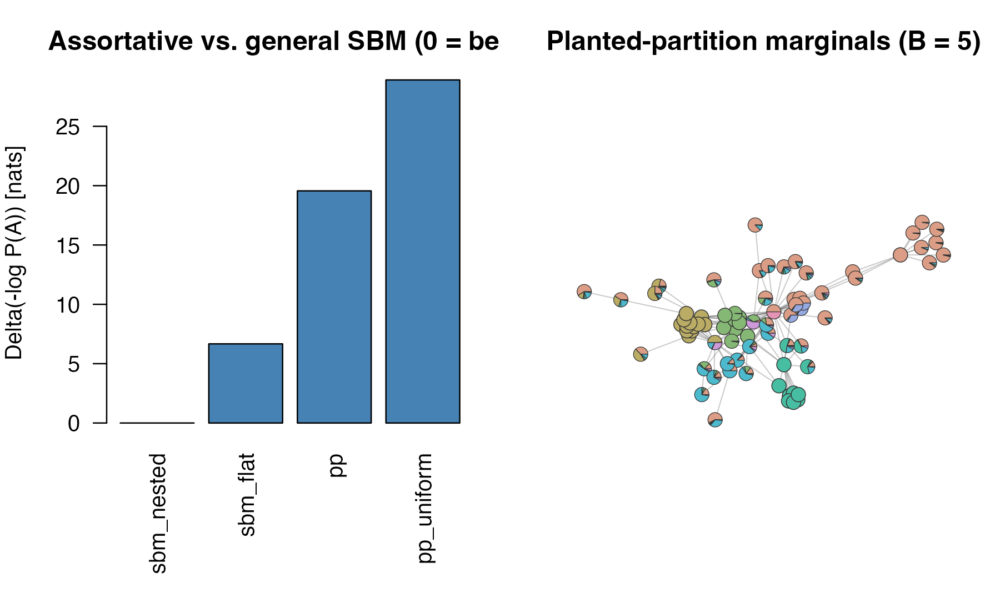
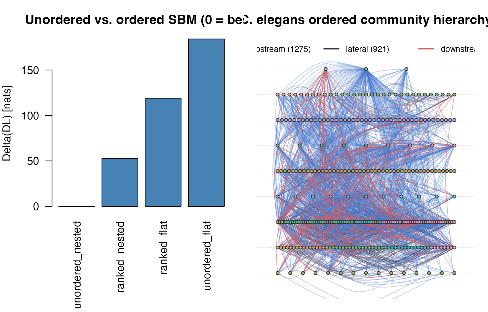

# Assortative & Ordered (Ranked) Communities

This article combines the `assortative_sbm` and `ordered_sbm` demos,
covering two specialized microcanonical SBM priors: the
**planted-partition SBM** for assortative community detection (Zhang &
Peixoto 2020) and the **ranked (ordered) SBM** for discovering directed
feed-forward hierarchies (Peixoto 2022).

## 1. Assortative community structure (planted-partition SBM)

The planted-partition model restricts block interactions to within-group
vs. between-group densities, yielding a sharper prior whenever community
structure is predominantly assortative.
[`compare_assortative_models()`](https://diogro.github.io/rgraphtool/reference/pp_block_state.md)
tests non-uniform and uniform planted-partition models directly against
general flat and nested SBMs.

``` r

lesmis <- load_or_fallback_lesmis()
g_lm <- lesmis$graph

set.seed(42)
pp_nu <- minimize_pp_blockmodel_dl(g_lm, uniform = FALSE)
pp_u  <- minimize_pp_blockmodel_dl(g_lm, uniform = TRUE)
print(pp_nu)
#> <planted-partition block state: degree-corrected, non-uniform assortativity, B = 5 (Be = 4.60), E_in/E = 76.8%, DL = 719.4225 nats>
pp_assortativity(pp_nu)
#> $E_in
#> [1] 195
#> 
#> $E_out
#> [1] 59
#> 
#> $E_total
#> [1] 254
#> 
#> $fraction_in
#> [1] 0.7677165
#> 
#> $B
#> [1] 5
#> 
#> $Be
#> [1] 4.598904
#> 
#> $err
#> [1] 43 32 29 16 75

set.seed(42)
cmp_pp <- compare_assortative_models(
  g_lm,
  models = c("pp", "pp_uniform", "sbm_flat", "sbm_nested"),
  method = "posterior",
  nsamples = 80L,
  thin = 5L,
  burnin = 40L
)
print(cmp_pp)
#> <assortative vs. general SBM comparison (DC, posterior/variational)>
#>       model B description_length posterior_entropy neg_log_evidence  delta
#>  sbm_nested 7            705.959            38.531          683.363  0.000
#>    sbm_flat 6            706.720            23.132          690.033  6.669
#>          pp 5            719.422            36.175          702.923 19.560
#>  pp_uniform 4            725.074            16.638          712.270 28.907
#>  posterior_weight
#>          9.99e-01
#>          1.27e-03
#>          3.20e-09
#>          2.79e-13
#> Best model: sbm_nested

set.seed(42)
post_pp <- sample_posterior(pp_nu, nsamples = 80L, thin = 5L, burnin = 40L)
mode_pp <- partition_mode_state(post_pp$samples)

old_par <- graphics::par(mfrow = c(1L, 2L), mar = c(7, 4, 3, 1))
tab <- cmp_pp$summary
graphics::barplot(
  tab$delta,
  names.arg = tab$model,
  las = 2,
  ylab = "Delta(-log P(A)) [nats]",
  col = ifelse(tab$model == cmp_pp$best_model, "darkorange", "steelblue"),
  main = "Assortative vs. general SBM (0 = best)"
)
graphics::par(mar = c(2, 2, 3, 1))
plot_marginals(
  g_lm, mode_pp,
  main = sprintf("Planted-partition marginals (B = %d)", pp_nu$B)
)
```



``` r

graphics::par(old_par)
```

## 2. Ordered (ranked) communities in directed networks

For directed networks with directional flow (such as neural circuits,
food webs, or citation hierarchies),
[`ranked_block_state()`](https://diogro.github.io/rgraphtool/reference/ranked_block_state.md)
and
[`nested_ranked_block_state()`](https://diogro.github.io/rgraphtool/reference/ranked_block_state.md)
jointly infer group memberships and a latent rank ordering \\u_r\\
separating upstream (\\u_i \< u_j\\), lateral (\\u_i = u_j\\), and
downstream (\\u_i \> u_j\\) edges.

``` r

celegans <- load_or_fallback_celegans()
g_ce <- celegans$graph

set.seed(42)
cmp_ord <- compare_ordered_models(
  g_ce,
  models = c("unordered_flat", "unordered_nested",
             "ranked_flat", "ranked_nested"),
  method = "map",
  nruns = 2L
)
print(cmp_ord)
#> <ordered (ranked) vs. unordered SBM comparison (DC, MAP)>
#>             model  B description_length   delta posterior_weight
#>  unordered_nested 22           8531.236   0.000         1.00e+00
#>     ranked_nested 20           8583.880  52.644         1.37e-23
#>       ranked_flat 15           8650.186 118.950         2.19e-52
#>    unordered_flat 12           8715.276 184.040         1.18e-80
#> Best model: unordered_nested

rk_nest <- cmp_ord$states$ranked_nested
ec <- ranked_edge_counts(rk_nest)
ec_tot <- ec$upstream + ec$lateral + ec$downstream
cat(sprintf(
  "Nested ranked SBM flow: %d upstream (%.1f%%), %d lateral (%.1f%%), %d downstream (%.1f%%)\n",
  ec$upstream, 100 * ec$upstream / ec_tot,
  ec$lateral, 100 * ec$lateral / ec_tot,
  ec$downstream, 100 * ec$downstream / ec_tot
))
#> Nested ranked SBM flow: 1275 upstream (54.0%), 921 lateral (39.0%), 163 downstream (6.9%)

old_par <- graphics::par(mfrow = c(1L, 2L), mar = c(8, 4, 3, 1))
tab_o <- cmp_ord$summary
graphics::barplot(
  tab_o$delta,
  names.arg = tab_o$model,
  las = 2,
  ylab = "Delta(DL) [nats]",
  col = ifelse(tab_o$model == cmp_ord$best_model, "darkorange", "steelblue"),
  main = "Unordered vs. ordered SBM (0 = best)"
)
graphics::par(mar = c(1, 1, 3, 1))
plot_ranked_hierarchy(
  rk_nest,
  vertex_cex = 0.65,
  main = "C. elegans ordered community hierarchy"
)
```



``` r

graphics::par(old_par)
```
