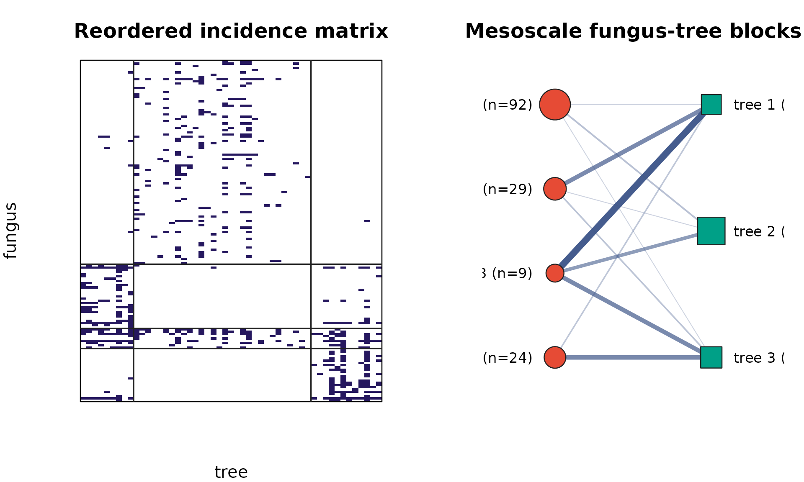

# Bipartite & Ecological Networks: The Fungus-Tree Case Study

This article reproduces and extends the classic ecological case study
from the [`sbm` R package](https://grosssbm.github.io/sbm/)
(`fungusTreeNetwork`, originating from Vacher, Piou & Desprez-Loustau
2008, *PLoS ONE* 3(3): e1740) using `rgraphtool`’s native C++23
microcanonical Bipartite Stochastic Block Model (Yen & Larremore 2020)
and weighted edge-covariate SBMs (Peixoto 2018).

The bundled dataset
[`fungus_tree_network()`](https://diogro.github.io/rgraphtool/reference/bipartite_block_state.md)
records antagonistic interactions between **154 fungal species** and
**51 European tree species**, along with the projected \\(51 \times
51\\) tree–tree shared-fungus count matrix and pairwise genetic,
taxonomic, and geographic distances between trees.

## 1. Inspecting the fungus–tree network

[`fungus_tree_network()`](https://diogro.github.io/rgraphtool/reference/bipartite_block_state.md)
returns both the raw matrices and a validated `rgraphtool_graph` with
vertex `"type"` (`FALSE` for fungi, `TRUE` for trees) and `"name"`
property maps:

\
`ft`` ``<-`` `[`fungus_tree_network`](https://diogro.github.io/rgraphtool/reference/bipartite_block_state.md)`(``)`\
[`dim`](https://rdrr.io/r/base/dim.html)`(``ft``$``fungus_tree``)`\
`#> [1] 154  51`\
[`sum`](https://rdrr.io/r/base/sum.html)`(``ft``$``fungus_tree``)`\
`#> [1] 543`\
\
`ft``$``graph`\
`#> rgraphtool graph (undirected, 205 vertices, 543 edges)`\
`#>   graph props: dim_labels (chr)`\
`#>   vertex props: type (lgl), name (chr)`\
`#>   edges:`\
`#>     1--191, 1--194, 1--195, 2--158, 2--166, 2--191, 2--192, 2--194, 2--195,`\
`#>     2--203, 3--185, 4--156, 4--158, 4--164, 4--171, 4--172, 5--155, 5--156,`\
`#>     5--157, 5--158, ... (+523 more)`\
[`is_bipartite`](https://diogro.github.io/rgraphtool/reference/bipartite_block_state.md)`(``ft``$``graph``)`\
`#> [1] TRUE`

## 2. Fitting a microcanonical Bipartite SBM

Just like `sbm::estimateBipartiteSBM()`,
[`minimize_bipartite_blockmodel_dl()`](https://diogro.github.io/rgraphtool/reference/bipartite_block_state.md)
accepts a rectangular incidence matrix directly (or a
[`bipartite_graph()`](https://diogro.github.io/rgraphtool/reference/bipartite_block_state.md)
object). Rather than requiring a grid search over block numbers with
variational EM, `rgraphtool` minimizes the exact microcanonical
bipartite description length \\(\Sigma\\) in C++23—using the bipartite
edge-count prior \\(\ln\binom{B\_{\text{fungus}} B\_{\text{tree}} + E -
1}{E}\\) to select \\((B\_{\text{fungus}}, B\_{\text{tree}})\\)
automatically without resolution-limit penalties from impossible
intra-type edges:

\
[`set.seed`](https://rdrr.io/r/base/Random.html)`(``42``)`\
`fit_bip`` ``<-`` `[`minimize_bipartite_blockmodel_dl`](https://diogro.github.io/rgraphtool/reference/bipartite_block_state.md)`(`\
`  ``ft``$``fungus_tree``,`\
`  dim_labels ``=`` `[`c`](https://rdrr.io/r/base/c.html)`(``"fungus"``, ``"tree"``)``,`\
`  nruns ``=`` ``3L`\
`)`\
`fit_bip`\
`#> <bipartite block state (degree-corrected, unweighted, edge_prior = bipartite)>`\
`#>   fungus: 154 vertices -> 4 blocks`\
`#>   tree: 51 vertices -> 3 blocks`\
`#>   edges: 543 | description length: 1691.3277 nats`\
\
`# Separate 1-based block memberships for fungi and trees (with species names)`\
`mem`` ``<-`` `[`bipartite_membership`](https://diogro.github.io/rgraphtool/reference/bipartite_block_state.md)`(``fit_bip``)`\
[`table`](https://rdrr.io/r/base/table.html)`(``fungus_block ``=`` ``mem``$``fungus``)`\
`#> fungus_block`\
`#>  1  2  3  4 `\
`#> 92 29  9 24`\
[`table`](https://rdrr.io/r/base/table.html)`(``tree_block ``=`` ``mem``$``tree``)`\
`#> tree_block`\
`#>  1  2  3 `\
`#>  9 30 12`\
\
`# Rectangular B_fungus x B_tree interaction density matrix`\
[`round`](https://rdrr.io/r/base/Round.html)`(`[`bipartite_block_matrix`](https://diogro.github.io/rgraphtool/reference/bipartite_block_state.md)`(``fit_bip``, normalize ``=`` ``"density"``)``, ``3``)`\
`#>           tree`\
`#> fungus     tree_1 tree_2 tree_3`\
`#>   fungus_1  0.008  0.074  0.001`\
`#>   fungus_2  0.295  0.002  0.063`\
`#>   fungus_3  0.481  0.222  0.296`\
`#>   fungus_4  0.056  0.000  0.306`\
\
`# Reordered incidence matrix ("data" view) and mesoscale block diagram ("meso" view)`\
`old_par`` ``<-`` ``graphics``::`[`par`](https://rdrr.io/r/graphics/par.html)`(``mfrow ``=`` `[`c`](https://rdrr.io/r/base/c.html)`(``1L``, ``2L``)``, mar ``=`` `[`c`](https://rdrr.io/r/base/c.html)`(``4``, ``4``, ``3``, ``1``)``)`\
[`plot_bipartite`](https://diogro.github.io/rgraphtool/reference/plot_bipartite.md)`(``fit_bip``, type ``=`` ``"matrix"``, main ``=`` ``"Reordered incidence matrix"``)`\
[`plot_bipartite`](https://diogro.github.io/rgraphtool/reference/plot_bipartite.md)`(``fit_bip``, type ``=`` ``"meso"``, main ``=`` ``"Mesoscale fungus-tree blocks"``)`

\
`graphics``::`[`par`](https://rdrr.io/r/graphics/par.html)`(``old_par``)`

## 3. Degree correction, hierarchy & Bayesian posterior sampling

Ecological interaction networks typically exhibit pronounced degree
heterogeneity (generalist vs. specialist species).
[`compare_bipartite_models()`](https://diogro.github.io/rgraphtool/reference/bipartite_block_state.md)
compares degree-corrected (DC) vs. non-degree-corrected (NDC) and flat
vs. hierarchical (nested) bipartite SBMs by exact description length:

\
[`set.seed`](https://rdrr.io/r/base/Random.html)`(``42``)`\
`cmp`` ``<-`` `[`compare_bipartite_models`](https://diogro.github.io/rgraphtool/reference/bipartite_block_state.md)`(`\
`  ``ft``$``fungus_tree``,`\
`  dim_labels ``=`` `[`c`](https://rdrr.io/r/base/c.html)`(``"fungus"``, ``"tree"``)``,`\
`  nruns ``=`` ``2L`\
`)`\
`cmp`\
`#> <bipartite block model comparison>`\
`#>       model nested degree_corrected B_row B_col description_length  delta_dl`\
`#>     flat_dc  FALSE             TRUE     4     3           1691.328  0.000000`\
`#>   nested_dc   TRUE             TRUE     4     3           1692.454  1.126002`\
`#>    flat_ndc  FALSE            FALSE     4     4           1736.366 45.038276`\
`#>  nested_ndc   TRUE            FALSE     4     3           1768.932 77.604165`\
`#> Best model: flat_dc`\
\
`# Finite-temperature MCMC posterior sampling around the MAP bipartite state`\
[`set.seed`](https://rdrr.io/r/base/Random.html)`(``42``)`\
`post`` ``<-`` `[`sample_posterior`](https://diogro.github.io/rgraphtool/reference/mcmc_sweep.md)`(``fit_bip``, nsamples ``=`` ``50L``, burnin ``=`` ``25L``, thin ``=`` ``2L``)`\
[`summary`](https://rdrr.io/r/base/summary.html)`(``post``$``entropies``)`\
`#>    Min. 1st Qu.  Median    Mean 3rd Qu.    Max. `\
`#>    1697    1712    1728    1727    1735    1782`

## 4. Simple & covariate-weighted SBMs on the tree–tree network

Following the second half of the `GrossSBM/sbm` tutorial, we also
analyze the unipartite \\(51 \times 51\\) `tree_tree` network (counting
how many fungal parasites each pair of tree species shares), comparing a
binary topology SBM, a Poisson count SBM (`discrete-poisson`), and a
multi-covariate SBM incorporating taxonomic distance
(`covar_tree$taxonomic_dist`):

\
`tree_mat`` ``<-`` ``ft``$``tree_tree`\
[`diag`](https://rdrr.io/r/base/diag.html)`(``tree_mat``)`` ``<-`` ``0`\
`idx`` ``<-`` `[`which`](https://rdrr.io/r/base/which.html)`(`[`upper.tri`](https://rdrr.io/r/base/lower.tri.html)`(``tree_mat``)`` ``&`` ``tree_mat`` ``>`` ``0``, arr.ind ``=`` ``TRUE``)`\
\
`g_tree`` ``<-`` `[`graph_create`](https://diogro.github.io/rgraphtool/reference/graph.md)`(`[`nrow`](https://rdrr.io/r/base/nrow.html)`(``tree_mat``)``, directed ``=`` ``FALSE``)`\
[`graph_set_vertex_property`](https://diogro.github.io/rgraphtool/reference/graph.md)`(``g_tree``, ``"name"``, ``ft``$``tree_names``)`\
[`graph_add_edges`](https://diogro.github.io/rgraphtool/reference/graph.md)`(`\
`  ``g_tree``,`\
`  ``idx``,`\
`  properties ``=`` `[`list`](https://rdrr.io/r/base/list.html)`(`\
`    shared_fungi ``=`` ``tree_mat``[``idx``]``,`\
`    genetic_dist ``=`` ``ft``$``covar_tree``$``genetic_dist``[``idx``]``,`\
`    taxonomic_dist ``=`` ``ft``$``covar_tree``$``taxonomic_dist``[``idx``]``,`\
`    geographic_dist ``=`` ``ft``$``covar_tree``$``geographic_dist``[``idx``]`\
`  ``)`\
`)`\
`g_tree`\
`#> rgraphtool graph (undirected, 51 vertices, 688 edges)`\
`#>   vertex props: name (chr)`\
`#>   edge props: genetic_dist (dbl), geographic_dist (dbl), shared_fungi (dbl), taxonomic_dist (dbl)`\
`#>   edges:`\
`#>     1--2, 1--3, 1--4, 1--5, 1--6, 1--9, 1--10, 1--11, 1--12, 1--13, 1--14,`\
`#>     1--15, 1--16, 1--17, 1--18, 1--19, 1--20, 1--21, 1--22, 1--23, ... (+668`\
`#>     more)`\
\
[`set.seed`](https://rdrr.io/r/base/Random.html)`(``42``)`\
`fit_tree_bin`` ``<-`` `[`minimize_blockmodel_dl`](https://diogro.github.io/rgraphtool/reference/minimize_blockmodel_dl.md)`(``g_tree``)`\
`fit_tree_poi`` ``<-`` `[`minimize_weighted_blockmodel_dl`](https://diogro.github.io/rgraphtool/reference/weighted_block_state.md)`(`\
`  ``g_tree``, weights ``=`` ``"shared_fungi"``, types ``=`` ``"discrete-poisson"`\
`)`\
`fit_tree_cov`` ``<-`` `[`minimize_weighted_blockmodel_dl`](https://diogro.github.io/rgraphtool/reference/weighted_block_state.md)`(`\
`  ``g_tree``,`\
`  weights ``=`` `[`c`](https://rdrr.io/r/base/c.html)`(``"shared_fungi"``, ``"taxonomic_dist"``)``,`\
`  types ``=`` `[`c`](https://rdrr.io/r/base/c.html)`(``"discrete-poisson"``, ``"real-exponential"``)`\
`)`\
\
[`cat`](https://rdrr.io/r/base/cat.html)`(`[`sprintf`](https://rdrr.io/r/base/sprintf.html)`(``"Binary tree SBM: %d blocks (DL = %.2f nats)\n"``,`\
`            `[`length`](https://rdrr.io/r/base/length.html)`(`[`block_sizes`](https://diogro.github.io/rgraphtool/reference/block_state.md)`(``fit_tree_bin``)``)``,`\
`            `[`block_description_length`](https://diogro.github.io/rgraphtool/reference/block_state.md)`(``fit_tree_bin``)``)``)`\
`#> Binary tree SBM: 1 blocks (DL = 1001.38 nats)`\
[`print`](https://rdrr.io/r/base/print.html)`(``fit_tree_poi``)`\
`#> <weighted block state: degree-corrected, discrete-poisson, B = 5, description length 2213.8415 nats>`\
[`print`](https://rdrr.io/r/base/print.html)`(``fit_tree_cov``)`\
`#> <weighted block state: degree-corrected, discrete-poisson+real-exponential, B = 6, description length 2633.0294 nats>`

## 5. Exporting & round-tripping with `graph-tool` (`.gt`) and `igraph`

Because
[`bipartite_graph()`](https://diogro.github.io/rgraphtool/reference/bipartite_block_state.md)
stores `"type"` and `"name"` as standard vertex property maps and
`"dim_labels"` as a graph property map, bipartite networks round-trip
losslessly through both Python `graph-tool`’s binary `.gt` format and
R’s `igraph` package:

\
`gt_path`` ``<-`` `[`tempfile`](https://rdrr.io/r/base/tempfile.html)`(``fileext ``=`` ``".gt.gz"``)`\
[`write_gt`](https://diogro.github.io/rgraphtool/reference/graph_io.md)`(``ft``$``graph``, ``gt_path``)`\
`g_reloaded`` ``<-`` `[`read_gt`](https://diogro.github.io/rgraphtool/reference/graph_io.md)`(``gt_path``)`\
[`unlink`](https://rdrr.io/r/base/unlink.html)`(``gt_path``)`\
\
[`identical`](https://rdrr.io/r/base/identical.html)`(`[`as_incidence_matrix`](https://diogro.github.io/rgraphtool/reference/bipartite_block_state.md)`(``g_reloaded``)``, ``ft``$``fungus_tree``)`\
`#> [1] FALSE`\
\
`if`` ``(`[`requireNamespace`](https://rdrr.io/r/base/ns-load.html)`(``"igraph"``, quietly ``=`` ``TRUE``)``)`` ``{`\
`  ``ig`` ``<-`` `[`as_igraph`](https://diogro.github.io/rgraphtool/reference/graph_io.md)`(``ft``$``graph``)`\
`  `[`cat`](https://rdrr.io/r/base/cat.html)`(`[`sprintf`](https://rdrr.io/r/base/sprintf.html)`(``"igraph bipartite: %s (%d vertices, %d edges)\n"``,`\
`              ``igraph``::`[`is_bipartite`](https://r.igraph.org/reference/is_bipartite.html)`(``ig``)``, ``igraph``::`[`vcount`](https://r.igraph.org/reference/gorder.html)`(``ig``)``, ``igraph``::`[`ecount`](https://r.igraph.org/reference/gsize.html)`(``ig``)``)``)`\
`  ``g_from_ig`` ``<-`` `[`bipartite_graph`](https://diogro.github.io/rgraphtool/reference/bipartite_block_state.md)`(``ig``)`\
`  `[`identical`](https://rdrr.io/r/base/identical.html)`(`[`as_incidence_matrix`](https://diogro.github.io/rgraphtool/reference/bipartite_block_state.md)`(``g_from_ig``)``, ``ft``$``fungus_tree``)`\
`}`\
`#> igraph bipartite: TRUE (205 vertices, 543 edges)`\
`#> [1] FALSE`

## References

- Vacher, C., Piou, D., & Desprez-Loustau, M.-L. (2008). Architecture of
  an antagonistic tree/fungus network: the asymmetric influence of past
  evolutionary history. *PLoS ONE*, 3(3), e1740.
- Yen, T.-C., & Larremore, D. B. (2020). Community detection in
  bipartite networks with stochastic block models. *Physical Review E*,
  102(3), 032309.
- Chiquet, J., Donnet, S., & Barbillon, P. (`GrossSBM/sbm`): *Stochastic
  Blockmodels* R package (<https://grosssbm.github.io/sbm/>).
