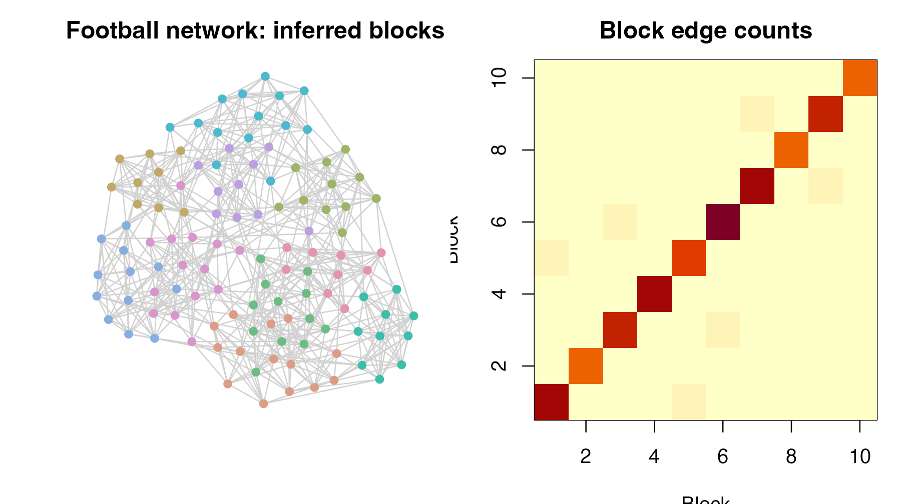
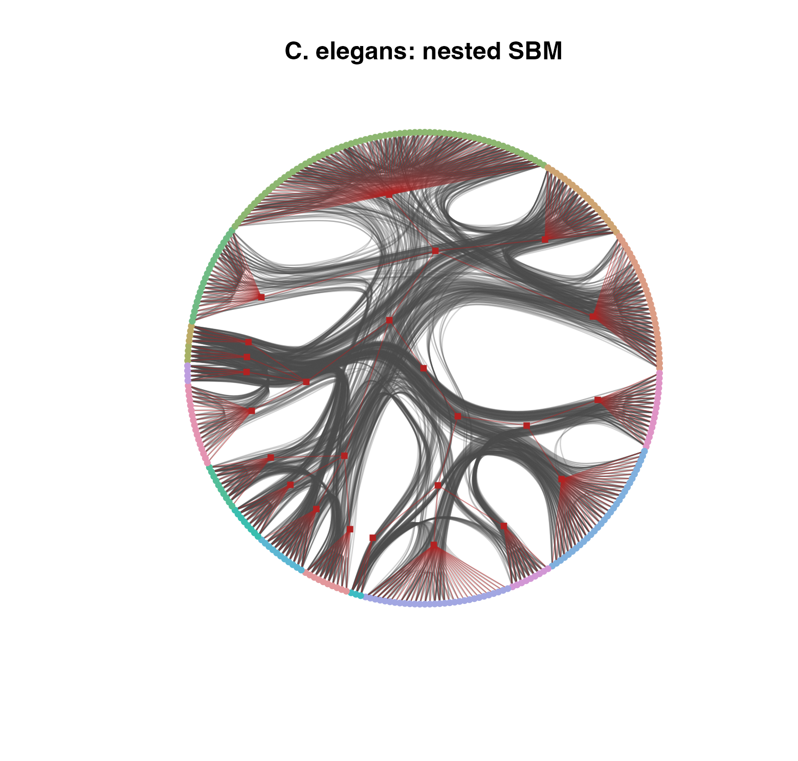

# Stochastic Block Models & Hierarchical Partitions

This article brings together the `football`, `celegans`, and
`model_selection` cookbook workflows, introducing flat and hierarchical
(nested) stochastic block models (SBMs) and minimum-description-length
(MDL) model selection between degree-corrected (DC) and
non-degree-corrected (NDC) variants.

## 1. Flat SBM inference on the college football network

In a flat SBM, each vertex \\i\\ is assigned to a group \\b_i \in \\1,
\dots, B\\\\, and we minimize the exact microcanonical description
length \\\Sigma(A, b)\\ combining the graph likelihood and the prior
entropy of the partition and block edge counts.
[`compare_blockmodels()`](https://diogro.github.io/rgraphtool/reference/minimize_blockmodel_dl.md)
fits both degree-corrected and non-degree-corrected models and computes
the posterior odds ratio between them.

``` r

football <- load_or_fallback_football()
g <- football$graph

set.seed(43)
comparison <- compare_blockmodels(g)
print(comparison$comparison)
#>                  model description_length
#> 1 non-degree-corrected           1740.158
#> 2     degree-corrected           1787.363

state <- comparison$best_state
block_sizes(state)
#>  1  2  3  4  5  6  7  8  9 10 
#> 14  9 11 12 10 14 12 10 14  9

pos <- football$positions
edges <- graph_edges(g)
groups <- match(block_membership(state), sort(unique(block_membership(state))))
colors <- grDevices::hcl.colors(max(groups), "Dynamic")

old_par <- graphics::par(mfrow = c(1L, 2L), mar = c(3.5, 3.5, 2.5, 1))
graphics::plot(pos, type = "n", xlab = "", ylab = "", axes = FALSE, asp = 1)
graphics::segments(pos[edges[, 1L], 1L], pos[edges[, 1L], 2L],
                   pos[edges[, 2L], 1L], pos[edges[, 2L], 2L], col = "grey82")
graphics::points(pos, pch = 19L, col = colors[groups], cex = 0.85)
graphics::title("Football network: inferred blocks")

counts <- block_edge_counts(state)
graphics::image(seq_len(nrow(counts)), seq_len(ncol(counts)), counts,
                xlab = "Block", ylab = "Block", main = "Block edge counts")
```



``` r

graphics::par(old_par)
```

## 2. Hierarchical (nested) SBM on *C. elegans*

Flat SBMs have a resolution limit proportional to \\\sqrt{N}\\ when
\\B\\ grows. The nested SBM resolves this by modeling the block
multigraph recursively as another SBM at higher levels \\\ell = 1, 2,
\dots, L\\.

``` r

celegans <- load_or_fallback_celegans()
g_ce <- celegans$graph

set.seed(1)
nstate <- minimize_nested_blockmodel_dl(g_ce)
print(nstate)
#> <nested block state: degree-corrected, 10 levels, description length 8581.5135 nats>
#> l: 0, N: 297, B: 17
#> l: 1, N: 17, B: 5
#> l: 2, N: 5, B: 2
#> l: 3, N: 2, B: 1
#> l: 4, N: 1, B: 1
nested_summary(nstate)
#>   level   N  B description_length
#> 1     0 297 17         7819.89474
#> 2     1  17  5          633.80424
#> 3     2   5  2          105.61259
#> 4     3   2  1           22.20191
#> 5     4   1  1            0.00000

# Project a single vertex's group membership across every level of the hierarchy
v_id <- min(47L, graph_num_vertices(g_ce))
sapply(seq_len(nrow(nested_summary(nstate))) - 1L,
       function(l) nested_project(nstate, l)[v_id])
#> [1] 5 1 1 1 1

# Inspect level-0 group sizes as a flat block state
level0 <- nested_level_state(nstate, 0L)
block_sizes(level0)
#>  1  2  3  4  5  6  7  8  9 10 11 12 13 14 15 16 17 
#> 29 20  4  4 70 21 10  8  3 11 31 30  4  9 16 17 10

plot_hierarchy(nstate, main = "C. elegans: nested SBM")
```



## 3. Degree-corrected vs. non-degree-corrected nested model selection

Using `compare_blockmodels(..., nested = TRUE)` evaluates whether
empirical degree heterogeneity warrants the degree-corrected
microcanonical prior. On networks with broad degree distributions (such
as political blogs), the DC nested SBM achieves a decisively lower
description length; on nearly regular networks (such as college
football), the simpler NDC model is often preferred.

``` r

set.seed(1)
cmp_fb <- compare_blockmodels(football$graph, nested = TRUE, nruns = 3L)
print(cmp_fb)
#> <nested block model comparison>
#> non-degree-corrected:  description length    1733.5257 nats
#> degree-corrected:      description length    1782.0200 nats
#> ln Lambda (NDC vs DC): 48.4943, about 10^21 in favour of the non-degree-corrected model
cmp_fb$comparison
#>                  model description_length
#> 1 non-degree-corrected           1733.526
#> 2     degree-corrected           1782.020
```

When network access to Netzschleuder is available, the same comparison
runs on `polblogs` (`1,490` blogs, `19,090` directed links):

``` r

polblogs <- netzschleuder_network("polblogs")
set.seed(1)
compare_blockmodels(polblogs$graph, nested = TRUE)
```
