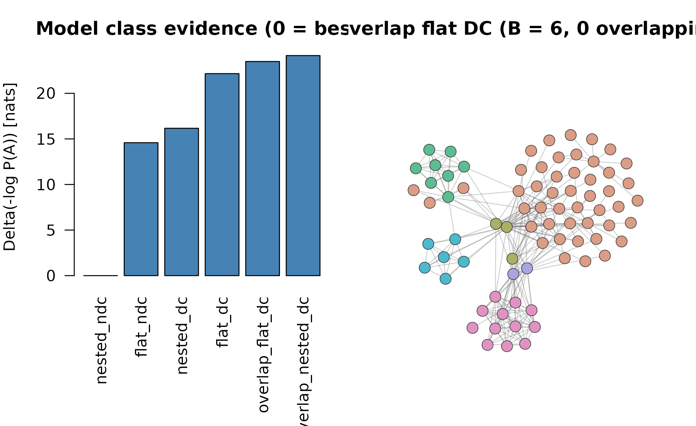

# Overlapping SBMs & Bayesian Model Class Selection

This article corresponds to `demo("model_class_selection")`. Choosing
among flat vs. nested, degree-corrected (DC) vs. non-degree-corrected
(NDC), and overlapping vs. non-overlapping SBMs requires integrating
over posterior uncertainty rather than comparing only MAP point
estimates. `rgraphtool` computes the full Bayesian marginal evidence:

\\\[-\ln P(A) = \langle \Sigma(A, b) \rangle\_{P(b \mid A)} -
\mathcal{H}(b),\\\]

where \\(\mathcal{H}(b)\\) is the posterior partition entropy estimated
via mode clustering.

## 1. MAP comparison across all 8 model classes

\
`lesmis`` ``<-`` ``load_or_fallback_lesmis``(``)`\
`g`` ``<-`` ``lesmis``$``graph`\
\
[`set.seed`](https://rdrr.io/r/base/Random.html)`(``42``)`\
`cmp_map`` ``<-`` `[`compare_model_classes`](https://diogro.github.io/rgraphtool/reference/compare_model_classes.md)`(``g``, method ``=`` ``"map"``, nruns ``=`` ``3L``)`\
[`print`](https://rdrr.io/r/base/print.html)`(``cmp_map``)`\
`#> <SBM model class comparison (MAP description length, distributed degree prior)>`\
`#>               model B levels description_length  delta posterior_weight`\
`#>    overlap_flat_ndc 8      1            685.101  0.000         8.70e-01`\
`#>     overlap_flat_dc 7      1            687.173  2.073         1.09e-01`\
`#>   overlap_nested_dc 7      8            689.119  4.019         1.56e-02`\
`#>  overlap_nested_ndc 7      8            690.268  5.167         4.96e-03`\
`#>          nested_ndc 7      8            694.065  8.965         1.11e-04`\
`#>             flat_dc 7      1            701.265 16.164         8.31e-08`\
`#>           nested_dc 6      8            705.282 20.182         1.49e-09`\
`#>            flat_ndc 6      1            710.230 25.129         1.06e-11`\
`#> Best model: overlap_flat_ndc`

## 2. Full Bayesian posterior marginal evidence

Integrating over the posterior via `method = "posterior"` properly
accounts for the Occam factor (posterior entropy) of each model class
and produces a pairwise log Bayes factor matrix.

\
[`set.seed`](https://rdrr.io/r/base/Random.html)`(``42``)`\
`cmp_post`` ``<-`` `[`compare_model_classes`](https://diogro.github.io/rgraphtool/reference/compare_model_classes.md)`(`\
`  ``g``,`\
`  models ``=`` `[`c`](https://rdrr.io/r/base/c.html)`(``"flat_ndc"``, ``"flat_dc"``, ``"nested_ndc"``, ``"nested_dc"``,`\
`             ``"overlap_flat_dc"``, ``"overlap_nested_dc"``)``,`\
`  method ``=`` ``"posterior"``,`\
`  nsamples ``=`` ``150L``,`\
`  thin ``=`` ``5L``,`\
`  burnin ``=`` ``50L`\
`)`\
[`print`](https://rdrr.io/r/base/print.html)`(``cmp_post``)`\
`#> <SBM model class comparison (posterior/variational, distributed degree prior)>`\
`#>              model B levels description_length posterior_entropy`\
`#>         nested_ndc 8      8            690.795            34.009`\
`#>           flat_ndc 8      1            718.562            13.644`\
`#>          nested_dc 7      8            703.371            36.015`\
`#>            flat_dc 6      1            700.726            22.842`\
`#>    overlap_flat_dc 6      1            692.710             5.350`\
`#>  overlap_nested_dc 7      8            691.713             6.415`\
`#>  neg_log_evidence  delta posterior_weight`\
`#>           668.195  0.000         1.00e+00`\
`#>           682.780 14.584         4.64e-07`\
`#>           684.363 16.168         9.52e-08`\
`#>           690.359 22.164         2.37e-10`\
`#>           691.690 23.495         6.26e-11`\
`#>           692.341 24.145         3.26e-11`\
`#> Best model: nested_ndc`\
\
`# Pairwise log Bayes factors (positive favors row over column)`\
[`round`](https://rdrr.io/r/base/Round.html)`(``cmp_post``$``log_bayes_factors``, ``2``)`\
`#>                   nested_ndc flat_ndc nested_dc flat_dc overlap_flat_dc`\
`#> nested_ndc              0.00    14.58     16.17   22.16           23.49`\
`#> flat_ndc              -14.58     0.00      1.58    7.58            8.91`\
`#> nested_dc             -16.17    -1.58      0.00    6.00            7.33`\
`#> flat_dc               -22.16    -7.58     -6.00    0.00            1.33`\
`#> overlap_flat_dc       -23.49    -8.91     -7.33   -1.33            0.00`\
`#> overlap_nested_dc     -24.15    -9.56     -7.98   -1.98           -0.65`\
`#>                   overlap_nested_dc`\
`#> nested_ndc                    24.15`\
`#> flat_ndc                       9.56`\
`#> nested_dc                      7.98`\
`#> flat_dc                        1.98`\
`#> overlap_flat_dc                0.65`\
`#> overlap_nested_dc              0.00`\
\
`old_par`` ``<-`` ``graphics``::`[`par`](https://rdrr.io/r/graphics/par.html)`(``mfrow ``=`` `[`c`](https://rdrr.io/r/base/c.html)`(``1L``, ``2L``)``, mar ``=`` `[`c`](https://rdrr.io/r/base/c.html)`(``8``, ``4``, ``3``, ``1``)``)`\
`tab`` ``<-`` ``cmp_post``$``summary`\
`graphics``::`[`barplot`](https://rdrr.io/r/graphics/barplot.html)`(`\
`  ``tab``$``delta``,`\
`  names.arg ``=`` ``tab``$``model``,`\
`  las ``=`` ``2``,`\
`  ylab ``=`` ``"Delta(-log P(A)) [nats]"``,`\
`  col ``=`` `[`ifelse`](https://rdrr.io/r/base/ifelse.html)`(``tab``$``model`` ``==`` ``cmp_post``$``best_model``, ``"darkorange"``, ``"steelblue"``)``,`\
`  main ``=`` ``"Model class evidence (0 = best)"`\
`)`\
\
`ov_st`` ``<-`` ``cmp_post``$``states``$``overlap_flat_dc`\
`ov_mat`` ``<-`` `[`overlap_groups`](https://diogro.github.io/rgraphtool/reference/overlap_block_state.md)`(``ov_st``)``$``matrix`\
`n_ov`` ``<-`` `[`sum`](https://rdrr.io/r/base/sum.html)`(`[`rowSums`](https://rdrr.io/r/base/colSums.html)`(``ov_mat`` ``>`` ``0L``)`` ``>`` ``1L``)`\
`graphics``::`[`par`](https://rdrr.io/r/graphics/par.html)`(``mar ``=`` `[`c`](https://rdrr.io/r/base/c.html)`(``2``, ``2``, ``3``, ``1``)``)`\
[`plot_marginals`](https://diogro.github.io/rgraphtool/reference/plot_marginals.md)`(`\
`  ``g``,`\
`  ``ov_mat``,`\
`  positions ``=`` ``lesmis``$``positions``,`\
`  radius ``=`` ``0.045``,`\
`  main ``=`` `[`sprintf`](https://rdrr.io/r/base/sprintf.html)`(``"Overlap flat DC (B = %d, %d overlapping)"``,`\
`                 `[`overlap_groups`](https://diogro.github.io/rgraphtool/reference/overlap_block_state.md)`(``ov_st``)``$``B``, ``n_ov``)`\
`)`

\
`graphics``::`[`par`](https://rdrr.io/r/graphics/par.html)`(``old_par``)`
