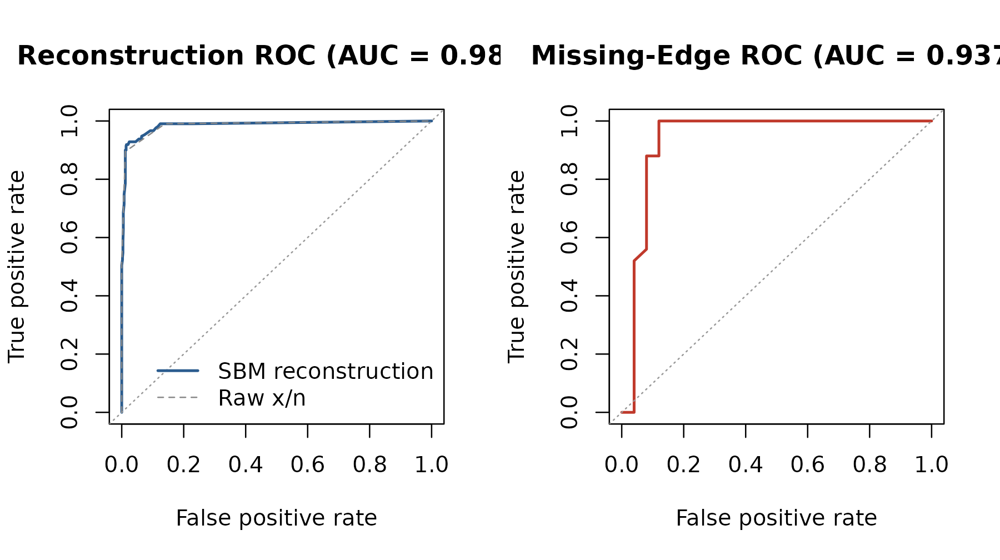

# Network Reconstruction: Uncertain Edges, Triadic Closure & Dynamics

This article brings together four reconstruction demos
(`uncertain_reconstruction`, `triadic_closure`,
`dynamics_reconstruction`, and `empirical_dynamics`), covering Bayesian
inference of latent networks from noisy measurements, triadic closure
mechanisms, and dynamical or behavioral time series.

## 1. Uncertain network reconstruction & missing-edge prediction

When edges are observed with false negatives (\\(p\\)) and false
positives (\\(q\\)) over repeated trials,
[`measured_block_state()`](https://diogro.github.io/rgraphtool/reference/uncertain_block_state.md)
jointly infers the underlying network \\(A\\), the hierarchical SBM
communities, and the error rates \\((p, q)\\). For heterogeneous errors
or extraneous probabilities, `rgraphtool` also provides
[`mixed_measured_block_state()`](https://diogro.github.io/rgraphtool/reference/uncertain_block_state.md),
[`uncertain_block_state()`](https://diogro.github.io/rgraphtool/reference/uncertain_block_state.md),
and fast EM latent Poisson multigraph inference
([`latent_multigraph()`](https://diogro.github.io/rgraphtool/reference/uncertain_block_state.md)).

\
[`set.seed`](https://rdrr.io/r/base/Random.html)`(``42``)`\
`N`` ``<-`` ``45L`\
`b_true`` ``<-`` `[`rep`](https://rdrr.io/r/base/rep.html)`(``1``:``3``, each ``=`` ``15L``)`\
`all_pairs`` ``<-`` `[`t`](https://rdrr.io/r/base/t.html)`(``utils``::`[`combn`](https://rdrr.io/r/utils/combn.html)`(``N``, ``2L``)``)`\
`same_blk`` ``<-`` ``b_true``[``all_pairs``[``, ``1L``]``]`` ``==`` ``b_true``[``all_pairs``[``, ``2L``]``]`\
`true_A`` ``<-`` `[`as.integer`](https://rdrr.io/r/base/integer.html)`(``stats``::`[`runif`](https://rdrr.io/r/stats/Uniform.html)`(`[`nrow`](https://rdrr.io/r/base/nrow.html)`(``all_pairs``)``)`` ``<`` `[`ifelse`](https://rdrr.io/r/base/ifelse.html)`(``same_blk``, ``0.65``, ``0.02``)``)`\
\
`# Repeated noisy observations (n = 3 trials, FN p = 0.20, FP q = 0.05)`\
`n_trials`` ``<-`` ``3L`\
`x_obs`` ``<-`` ``stats``::`[`rbinom`](https://rdrr.io/r/stats/Binomial.html)`(`[`nrow`](https://rdrr.io/r/base/nrow.html)`(``all_pairs``)``, ``n_trials``, `[`ifelse`](https://rdrr.io/r/base/ifelse.html)`(``true_A`` ``==`` ``1L``, ``0.80``, ``0.05``)``)`\
`keep`` ``<-`` ``x_obs`` ``>`` ``0L`\
\
`g_obs`` ``<-`` `[`graph_create`](https://diogro.github.io/rgraphtool/reference/graph.md)`(``N``, directed ``=`` ``FALSE``)`\
[`graph_add_edges`](https://diogro.github.io/rgraphtool/reference/graph.md)`(`\
`  ``g_obs``,`\
`  ``all_pairs``[``keep``, , drop ``=`` ``FALSE``]``,`\
`  properties ``=`` `[`list`](https://rdrr.io/r/base/list.html)`(``n ``=`` `[`rep`](https://rdrr.io/r/base/rep.html)`(``n_trials``, `[`sum`](https://rdrr.io/r/base/sum.html)`(``keep``)``)``, x ``=`` ``x_obs``[``keep``]``)`\
`)`\
\
`st_meas`` ``<-`` `[`measured_block_state`](https://diogro.github.io/rgraphtool/reference/uncertain_block_state.md)`(`\
`  ``g_obs``, n ``=`` ``"n"``, x ``=`` ``"x"``,`\
`  n_default ``=`` ``n_trials``, x_default ``=`` ``0L``,`\
`  nested ``=`` ``TRUE`\
`)`\
`rec_meas`` ``<-`` `[`reconstruct_network`](https://diogro.github.io/rgraphtool/reference/uncertain_block_state.md)`(``st_meas``, nsamples ``=`` ``120L``, burnin ``=`` ``100L``, thin ``=`` ``2L``)`\
[`print`](https://rdrr.io/r/base/print.html)`(``rec_meas``)`\
`#> <rgraphtool_reconstruction (measured)>`\
`#>   Marginal edges observed: 385 | Consensus edges (p >= 0.50): 197`\
`#>   Final description length: 1130.5609 | Moves: 13647 / 117197`\
`#>   Posterior mean FN rate (p): 0.1933 | FP rate (q): 0.0506`\
\
`ek`` ``<-`` ``function``(``u``, ``v``)`` `[`paste0`](https://rdrr.io/r/base/paste.html)`(`[`pmin`](https://rdrr.io/r/base/Extremes.html)`(``u``, ``v``)``, ``":"``, `[`pmax`](https://rdrr.io/r/base/Extremes.html)`(``u``, ``v``)``)`\
`idx`` ``<-`` `[`match`](https://rdrr.io/r/base/match.html)`(``ek``(``all_pairs``[``, ``1L``]``, ``all_pairs``[``, ``2L``]``)``,`\
`             ``ek``(``rec_meas``$``edges``$``from``, ``rec_meas``$``edges``$``to``)``)`\
`p_hat`` ``<-`` `[`ifelse`](https://rdrr.io/r/base/ifelse.html)`(`[`is.na`](https://rdrr.io/r/base/NA.html)`(``idx``)``, ``0``, ``rec_meas``$``edges``$``prob``[``idx``]``)`\
`ev_rec`` ``<-`` `[`evaluate_edge_prediction`](https://diogro.github.io/rgraphtool/reference/predict_edges.md)`(``p_hat``, ``true_A``)`\
`ev_raw`` ``<-`` `[`evaluate_edge_prediction`](https://diogro.github.io/rgraphtool/reference/predict_edges.md)`(``x_obs`` ``/`` ``n_trials``, ``true_A``)`\
\
`# Fast EM latent Poisson multigraph (Peixoto 2020)`\
`g_true`` ``<-`` `[`graph_add_edges`](https://diogro.github.io/rgraphtool/reference/graph.md)`(`[`graph_create`](https://diogro.github.io/rgraphtool/reference/graph.md)`(``N``, directed ``=`` ``FALSE``)``,`\
`                          ``all_pairs``[``true_A`` ``==`` ``1L``, , drop ``=`` ``FALSE``]``)`\
`em_res`` ``<-`` `[`latent_multigraph`](https://diogro.github.io/rgraphtool/reference/uncertain_block_state.md)`(``g_true``, epsilon ``=`` ``1e-10``)`\
[`print`](https://rdrr.io/r/base/print.html)`(``em_res``)`\
`#> <rgraphtool_latent_multigraph (undirected)>`\
`#>   Simple edges: 210 | Nonzero self-loops: 45 | Total expected weight: 245.768`\
`#>   EM iterations: 21 | Final delta: 3.988e-11`\
\
`# Missing-edge prediction on held-out edges`\
`true_edges`` ``<-`` ``all_pairs``[``true_A`` ``==`` ``1L``, , drop ``=`` ``FALSE``]`\
`non_edges`` ``<-`` ``all_pairs``[``true_A`` ``==`` ``0L``, , drop ``=`` ``FALSE``]`\
`hold_n`` ``<-`` `[`min`](https://rdrr.io/r/base/Extremes.html)`(``25L``, `[`floor`](https://rdrr.io/r/base/Round.html)`(`[`nrow`](https://rdrr.io/r/base/nrow.html)`(``true_edges``)`` ``*`` ``0.25``)``)`\
`hold_idx`` ``<-`` `[`sample`](https://rdrr.io/r/base/sample.html)`(`[`nrow`](https://rdrr.io/r/base/nrow.html)`(``true_edges``)``, ``hold_n``)`\
`g_train`` ``<-`` `[`graph_add_edges`](https://diogro.github.io/rgraphtool/reference/graph.md)`(`[`graph_create`](https://diogro.github.io/rgraphtool/reference/graph.md)`(``N``, directed ``=`` ``FALSE``)``,`\
`                           ``true_edges``[``-``hold_idx``, , drop ``=`` ``FALSE``]``)`\
`cands`` ``<-`` `[`rbind`](https://rdrr.io/r/base/cbind.html)`(``true_edges``[``hold_idx``, , drop ``=`` ``FALSE``]``,`\
`               ``non_edges``[`[`sample`](https://rdrr.io/r/base/sample.html)`(`[`nrow`](https://rdrr.io/r/base/nrow.html)`(``non_edges``)``, ``hold_n``)``, , drop ``=`` ``FALSE``]``)`\
`labels`` ``<-`` `[`c`](https://rdrr.io/r/base/c.html)`(`[`rep`](https://rdrr.io/r/base/rep.html)`(``1L``, ``hold_n``)``, `[`rep`](https://rdrr.io/r/base/rep.html)`(``0L``, ``hold_n``)``)`\
`pred`` ``<-`` `[`predict_edges`](https://diogro.github.io/rgraphtool/reference/predict_edges.md)`(``g_train``, ``cands``, nsamples ``=`` ``50L``, burnin ``=`` ``30L``, nested ``=`` ``TRUE``)`\
`ev_pred`` ``<-`` `[`evaluate_edge_prediction`](https://diogro.github.io/rgraphtool/reference/predict_edges.md)`(``pred``, ``labels``)`\
\
`old_par`` ``<-`` ``graphics``::`[`par`](https://rdrr.io/r/graphics/par.html)`(``mfrow ``=`` `[`c`](https://rdrr.io/r/base/c.html)`(``1L``, ``2L``)``)`\
`graphics``::`[`plot`](https://rdrr.io/r/graphics/plot.default.html)`(``ev_rec``$``roc``$``fpr``, ``ev_rec``$``roc``$``tpr``, type ``=`` ``"l"``, lwd ``=`` ``2``, col ``=`` ``"#2b5c8f"``,`\
`               xlab ``=`` ``"False positive rate"``, ylab ``=`` ``"True positive rate"``,`\
`               main ``=`` `[`sprintf`](https://rdrr.io/r/base/sprintf.html)`(``"Reconstruction ROC (AUC = %.3f)"``, ``ev_rec``$``roc_auc``)``)`\
`graphics``::`[`lines`](https://rdrr.io/r/graphics/lines.html)`(``ev_raw``$``roc``$``fpr``, ``ev_raw``$``roc``$``tpr``, lty ``=`` ``2``, col ``=`` ``"#888888"``)`\
`graphics``::`[`abline`](https://rdrr.io/r/graphics/abline.html)`(``0``, ``1``, lty ``=`` ``3``, col ``=`` ``"gray60"``)`\
`graphics``::`[`legend`](https://rdrr.io/r/graphics/legend.html)`(``"bottomright"``, legend ``=`` `[`c`](https://rdrr.io/r/base/c.html)`(``"SBM reconstruction"``, ``"Raw x/n"``)``,`\
`                 col ``=`` `[`c`](https://rdrr.io/r/base/c.html)`(``"#2b5c8f"``, ``"#888888"``)``, lty ``=`` `[`c`](https://rdrr.io/r/base/c.html)`(``1``, ``2``)``, lwd ``=`` `[`c`](https://rdrr.io/r/base/c.html)`(``2``, ``1``)``, bty ``=`` ``"n"``)`\
\
`graphics``::`[`plot`](https://rdrr.io/r/graphics/plot.default.html)`(``ev_pred``$``roc``$``fpr``, ``ev_pred``$``roc``$``tpr``, type ``=`` ``"l"``, lwd ``=`` ``2``, col ``=`` ``"#c0392b"``,`\
`               xlab ``=`` ``"False positive rate"``, ylab ``=`` ``"True positive rate"``,`\
`               main ``=`` `[`sprintf`](https://rdrr.io/r/base/sprintf.html)`(``"Missing-Edge ROC (AUC = %.3f)"``, ``ev_pred``$``roc_auc``)``)`\
`graphics``::`[`abline`](https://rdrr.io/r/graphics/abline.html)`(``0``, ``1``, lty ``=`` ``3``, col ``=`` ``"gray60"``)`

\
`graphics``::`[`par`](https://rdrr.io/r/graphics/par.html)`(``old_par``)`

## 2. Disentangling homophily and triadic closure

[`latent_closure_block_state()`](https://diogro.github.io/rgraphtool/reference/latent_closure_block_state.md)
and
[`infer_triadic_closure()`](https://diogro.github.io/rgraphtool/reference/latent_closure_block_state.md)
separate edges generated by a substrate SBM from edges formed by closing
open two-paths (Peixoto 2022 PRX).

\
[`set.seed`](https://rdrr.io/r/base/Random.html)`(``2026``)`\
`N_tc`` ``<-`` ``24L`\
`cyc1`` ``<-`` `[`rbind`](https://rdrr.io/r/base/cbind.html)`(`[`cbind`](https://rdrr.io/r/base/cbind.html)`(``1``:``11``, ``2``:``12``)``, `[`c`](https://rdrr.io/r/base/c.html)`(``12L``, ``1L``)``)`\
`cyc2`` ``<-`` `[`rbind`](https://rdrr.io/r/base/cbind.html)`(`[`cbind`](https://rdrr.io/r/base/cbind.html)`(``13``:``23``, ``14``:``24``)``, `[`c`](https://rdrr.io/r/base/c.html)`(``24L``, ``13L``)``)`\
`bridges`` ``<-`` `[`matrix`](https://rdrr.io/r/base/matrix.html)`(`[`c`](https://rdrr.io/r/base/c.html)`(``1L``, ``13L``, ``5L``, ``17L``, ``9L``, ``21L``)``, ncol ``=`` ``2L``, byrow ``=`` ``TRUE``)`\
`sub_edges`` ``<-`` `[`rbind`](https://rdrr.io/r/base/cbind.html)`(``cyc1``, ``cyc2``, ``bridges``)`\
\
`cl1`` ``<-`` `[`cbind`](https://rdrr.io/r/base/cbind.html)`(`[`seq`](https://rdrr.io/r/base/seq.html)`(``1L``, ``11L``, by ``=`` ``2L``)``, ``(`[`seq`](https://rdrr.io/r/base/seq.html)`(``3L``, ``13L``, by ``=`` ``2L``)`` ``-`` ``1L``)`` `[`%%`](https://rdrr.io/r/base/Arithmetic.html)` ``12L`` ``+`` ``1L``)`\
`cl2`` ``<-`` `[`cbind`](https://rdrr.io/r/base/cbind.html)`(`[`seq`](https://rdrr.io/r/base/seq.html)`(``13L``, ``23L``, by ``=`` ``2L``)``, ``12L`` ``+`` ``(``(`[`seq`](https://rdrr.io/r/base/seq.html)`(``3L``, ``13L``, by ``=`` ``2L``)`` ``-`` ``1L``)`` `[`%%`](https://rdrr.io/r/base/Arithmetic.html)` ``12L`` ``+`` ``1L``)``)`\
`cl_edges`` ``<-`` `[`rbind`](https://rdrr.io/r/base/cbind.html)`(``cl1``, ``cl2``)`\
\
`g_tc`` ``<-`` `[`graph_add_edges`](https://diogro.github.io/rgraphtool/reference/graph.md)`(`[`graph_create`](https://diogro.github.io/rgraphtool/reference/graph.md)`(``N_tc``, directed ``=`` ``FALSE``)``, `[`rbind`](https://rdrr.io/r/base/cbind.html)`(``sub_edges``, ``cl_edges``)``)`\
`st_tc`` ``<-`` `[`latent_closure_block_state`](https://diogro.github.io/rgraphtool/reference/latent_closure_block_state.md)`(``g_tc``, L ``=`` ``1L``, nested ``=`` ``TRUE``)`\
`res_tc`` ``<-`` `[`infer_triadic_closure`](https://diogro.github.io/rgraphtool/reference/latent_closure_block_state.md)`(``st_tc``, nsamples ``=`` ``180L``, burnin ``=`` ``150L``, thin ``=`` ``2L``)`\
\
`is_closure`` ``<-`` ``ek``(``res_tc``$``edges``$``from``, ``res_tc``$``edges``$``to``)`` `[`%in%`](https://rdrr.io/r/base/match.html)` ``ek``(``cl_edges``[``, ``1L``]``, ``cl_edges``[``, ``2L``]``)`\
`ev_tc`` ``<-`` `[`evaluate_edge_prediction`](https://diogro.github.io/rgraphtool/reference/predict_edges.md)`(``res_tc``$``edges``$``closure_prob``, `[`as.integer`](https://rdrr.io/r/base/integer.html)`(``is_closure``)``)`\
[`cat`](https://rdrr.io/r/base/cat.html)`(`[`sprintf`](https://rdrr.io/r/base/sprintf.html)`(`\
`  ``"Mean closure_prob: true closures = %.3f vs. substrate = %.3f | ROC-AUC = %.4f\n"``,`\
`  `[`mean`](https://rdrr.io/r/base/mean.html)`(``res_tc``$``edges``$``closure_prob``[``is_closure``]``)``,`\
`  `[`mean`](https://rdrr.io/r/base/mean.html)`(``res_tc``$``edges``$``closure_prob``[``!``is_closure``]``)``,`\
`  ``ev_tc``$``roc_auc`\
`)``)`\
`#> Mean closure_prob: true closures = 0.942 vs. substrate = 0.009 | ROC-AUC = 1.0000`

## 3. Reconstruction from synthetic dynamics (Ising, epidemics, Gaussian, Potts)

When only node states or time series are observed, `rgraphtool` supports
all 10 `graph-tool` dynamical/behavioral models with SBM + quantized MDL
or \\(L_1\\) priors, plus native C++ forward simulators.

\
[`set.seed`](https://rdrr.io/r/base/Random.html)`(``2026``)`\
\
`eval_graph`` ``<-`` ``function``(``rec``, ``g_true``)`` ``{`\
`  ``n_v`` ``<-`` `[`graph_num_vertices`](https://diogro.github.io/rgraphtool/reference/graph.md)`(``g_true``)`\
`  ``dir`` ``<-`` `[`isTRUE`](https://rdrr.io/r/base/Logic.html)`(``g_true``$``directed``)`\
`  ``key`` ``<-`` ``function``(``u``, ``v``)`` ``if`` ``(``!``dir``)`` `[`paste0`](https://rdrr.io/r/base/paste.html)`(`[`pmin`](https://rdrr.io/r/base/Extremes.html)`(``u``, ``v``)``, ``":"``, `[`pmax`](https://rdrr.io/r/base/Extremes.html)`(``u``, ``v``)``)`` ``else`` `[`paste0`](https://rdrr.io/r/base/paste.html)`(``u``, ``":"``, ``v``)`\
`  ``te`` ``<-`` `[`graph_edges`](https://diogro.github.io/rgraphtool/reference/graph.md)`(``g_true``)`\
`  ``tk`` ``<-`` `[`unique`](https://rdrr.io/r/base/unique.html)`(``key``(``te``[``, ``1L``]``, ``te``[``, ``2L``]``)``)`\
`  ``ap`` ``<-`` ``if`` ``(``dir``)`` ``{`\
`    ``eg`` ``<-`` `[`expand.grid`](https://rdrr.io/r/base/expand.grid.html)`(``u ``=`` `[`seq_len`](https://rdrr.io/r/base/seq.html)`(``n_v``)``, v ``=`` `[`seq_len`](https://rdrr.io/r/base/seq.html)`(``n_v``)``)`\
`    ``if`` ``(``!``rec``$``state``$``self_loops``)`` ``eg`` ``<-`` ``eg``[``eg``$``u`` ``!=`` ``eg``$``v``, , drop ``=`` ``FALSE``]`\
`    `[`cbind`](https://rdrr.io/r/base/cbind.html)`(``eg``$``u``, ``eg``$``v``)`\
`  ``}`` ``else`` ``{`\
`    `[`t`](https://rdrr.io/r/base/t.html)`(``utils``::`[`combn`](https://rdrr.io/r/utils/combn.html)`(``n_v``, ``2L``)``)`\
`  ``}`\
`  ``pk`` ``<-`` ``key``(``ap``[``, ``1L``]``, ``ap``[``, ``2L``]``)`\
`  ``y`` ``<-`` `[`as.integer`](https://rdrr.io/r/base/integer.html)`(``pk`` `[`%in%`](https://rdrr.io/r/base/match.html)` ``tk``)`\
`  ``rk`` ``<-`` ``key``(``rec``$``edges``$``from``, ``rec``$``edges``$``to``)`\
`  ``idx`` ``<-`` `[`match`](https://rdrr.io/r/base/match.html)`(``pk``, ``rk``)`\
`  ``sc`` ``<-`` `[`ifelse`](https://rdrr.io/r/base/ifelse.html)`(`[`is.na`](https://rdrr.io/r/base/NA.html)`(``idx``)``, ``0``, `[`abs`](https://rdrr.io/r/base/MathFun.html)`(``rec``$``edges``$``weight``[``idx``]``)`` ``*`` ``rec``$``edges``$``prob``[``idx``]``)`\
`  ``ev`` ``<-`` `[`evaluate_edge_prediction`](https://diogro.github.io/rgraphtool/reference/predict_edges.md)`(``sc``, ``y``, threshold ``=`` ``1e-6``)`\
`  `[`c`](https://rdrr.io/r/base/c.html)`(``roc_auc ``=`` ``ev``$``roc_auc``, f1 ``=`` ``ev``$``f1``, n_pred ``=`` `[`nrow`](https://rdrr.io/r/base/nrow.html)`(``rec``$``edges``)``, n_true ``=`` `[`sum`](https://rdrr.io/r/base/sum.html)`(``y``)``)`\
`}`\
\
`# Ground-truth undirected 2-community graph (20 vertices, 26 edges)`\
`g_u`` ``<-`` `[`graph_create`](https://diogro.github.io/rgraphtool/reference/graph.md)`(``20L``, directed ``=`` ``FALSE``)`\
[`graph_add_edges`](https://diogro.github.io/rgraphtool/reference/graph.md)`(``g_u``, `[`rbind`](https://rdrr.io/r/base/cbind.html)`(`\
`  `[`cbind`](https://rdrr.io/r/base/cbind.html)`(``1``:``9``, ``2``:``10``)``, `[`c`](https://rdrr.io/r/base/c.html)`(``10L``, ``1L``)``, `[`c`](https://rdrr.io/r/base/c.html)`(``1L``, ``5L``)``, `[`c`](https://rdrr.io/r/base/c.html)`(``3L``, ``8L``)``,`\
`  `[`cbind`](https://rdrr.io/r/base/cbind.html)`(``11``:``19``, ``12``:``20``)``, `[`c`](https://rdrr.io/r/base/c.html)`(``20L``, ``11L``)``, `[`c`](https://rdrr.io/r/base/c.html)`(``11L``, ``15L``)``, `[`c`](https://rdrr.io/r/base/c.html)`(``13L``, ``18L``)``,`\
`  `[`c`](https://rdrr.io/r/base/c.html)`(``1L``, ``11L``)``, `[`c`](https://rdrr.io/r/base/c.html)`(``6L``, ``16L``)`\
`)``)`\
\
`# 1. Equilibrium Ising: SBM+L1 vs pure L1 regularization path`\
`s_pi`` ``<-`` `[`simulate_ising`](https://diogro.github.io/rgraphtool/reference/simulate_dynamics.md)`(``g_u``, weights ``=`` ``0.55``, theta ``=`` ``0``,`\
`                       n_samples ``=`` ``600L``, burnin ``=`` ``300L``, thin ``=`` ``4L``, mode ``=`` ``"equilibrium"``)`\
`st_pi`` ``<-`` `[`pseudo_ising_block_state`](https://diogro.github.io/rgraphtool/reference/dynamics_block_state.md)`(``s_pi``, nested ``=`` ``TRUE``, xdelta ``=`` ``1e-4``, tdelta ``=`` ``1e-4``)`\
`rec_pi`` ``<-`` `[`reconstruct_dynamics`](https://diogro.github.io/rgraphtool/reference/dynamics_block_state.md)`(``st_pi``, niter ``=`` ``18L``, sbm ``=`` ``TRUE``,`\
`                               xdist ``=`` ``FALSE``, tdist ``=`` ``FALSE``, xl1 ``=`` ``1.0``, tl1 ``=`` ``0.1``)`\
`eval_graph``(``rec_pi``, ``g_u``)`\
`#> roc_auc      f1  n_pred  n_true `\
`#>       1       1      26      26`\
\
`l1_path`` ``<-`` `[`reconstruct_l1_path`](https://diogro.github.io/rgraphtool/reference/dynamics_block_state.md)`(``st_pi``, xl1_values ``=`` `[`c`](https://rdrr.io/r/base/c.html)`(``1``, ``5``, ``10``, ``20``)``,`\
`                               sbm ``=`` ``FALSE``, niter ``=`` ``12L``, truth ``=`` ``g_u``)`\
[`print`](https://rdrr.io/r/base/print.html)`(``l1_path``)`\
`#> <rgraphtool_l1_path (4 lambda values, best BIC at xl1 = 20)>`\
`#>  xl1 n_edges      nll  entropy       bic  l1_norm precision recall        f1`\
`#>   20      98 4516.665 6397.560  9788.167 15.91890 0.2653061      1 0.4193548`\
`#>   10     135 4463.694 6353.779  9918.912 19.57039 0.1925926      1 0.3229814`\
`#>    5     155 4442.808 6380.866 10005.078 22.37655 0.1677419      1 0.2872928`\
`#>    1     176 4434.585 6591.817 10122.968 25.15472 0.1477273      1 0.2574257`\
`#>  roc_auc`\
`#>        1`\
`#>        1`\
`#>        1`\
`#>        1`\
\
`# 2. Directed SIS epidemic cascades`\
`g_d`` ``<-`` `[`graph_create`](https://diogro.github.io/rgraphtool/reference/graph.md)`(``16L``, directed ``=`` ``TRUE``)`\
`e_d`` ``<-`` `[`rbind`](https://rdrr.io/r/base/cbind.html)`(`[`cbind`](https://rdrr.io/r/base/cbind.html)`(``1``:``15``, ``2``:``16``)``, `[`c`](https://rdrr.io/r/base/c.html)`(``16L``, ``1L``)``, `[`c`](https://rdrr.io/r/base/c.html)`(``1L``, ``5L``)``, `[`c`](https://rdrr.io/r/base/c.html)`(``5L``, ``9L``)``, `[`c`](https://rdrr.io/r/base/c.html)`(``9L``, ``13L``)``, `[`c`](https://rdrr.io/r/base/c.html)`(``13L``, ``1L``)``)`\
[`graph_add_edges`](https://diogro.github.io/rgraphtool/reference/graph.md)`(``g_d``, ``e_d``)`\
`casc`` ``<-`` `[`simulate_epidemics`](https://diogro.github.io/rgraphtool/reference/simulate_dynamics.md)`(``g_d``, transmission ``=`` ``0.45``, spontaneous ``=`` ``0.01``,`\
`                           recovery ``=`` ``0.3``, model ``=`` ``"SIS"``, n_steps ``=`` ``60L``, n_cascades ``=`` ``20L``)`\
`st_ep`` ``<-`` `[`epidemics_block_state`](https://diogro.github.io/rgraphtool/reference/dynamics_block_state.md)`(``casc``, directed ``=`` ``TRUE``, nested ``=`` ``FALSE``,`\
`                               xdelta ``=`` ``1e-4``, tdelta ``=`` ``1e-4``)`\
`rec_ep`` ``<-`` `[`reconstruct_dynamics`](https://diogro.github.io/rgraphtool/reference/dynamics_block_state.md)`(``st_ep``, niter ``=`` ``15L``, sbm ``=`` ``TRUE``,`\
`                               xdist ``=`` ``FALSE``, tdist ``=`` ``FALSE``, xl1 ``=`` ``1.0``, tl1 ``=`` ``0.1``)`\
`tp_ep`` ``<-`` `[`dynamics_transmission_probs`](https://diogro.github.io/rgraphtool/reference/dynamics_block_state.md)`(``rec_ep``)`\
[`c`](https://rdrr.io/r/base/c.html)`(``eval_graph``(``rec_ep``, ``g_d``)``, median_t_hat ``=`` ``stats``::`[`median`](https://rdrr.io/r/stats/median.html)`(``tp_ep``$``edges``$``transmission_prob``)``)`\
`#>      roc_auc           f1       n_pred       n_true median_t_hat `\
`#>    1.0000000    1.0000000   20.0000000   20.0000000    0.4464316`

## 4. Empirical financial partial-correlation network

For financial time series in
[`pseudo_normal_block_state()`](https://diogro.github.io/rgraphtool/reference/dynamics_block_state.md),
convert price levels \\(P_i(t)\\) to stationary log-returns \\(r_i(t) =
\ln(P_i(t+1)/P_i(t))\\), standardize each series to zero mean and unit
variance, and set `positive = TRUE` so the reconstructed precision
matrix \\(\Omega\\) is strictly positive-definite.

\
`prices`` ``<-`` `[`as.matrix`](https://rdrr.io/r/base/matrix.html)`(``datasets``::`[`EuStockMarkets`](https://rdrr.io/r/datasets/EuStockMarkets.html)`)`\
`log_ret`` ``<-`` `[`diff`](https://rdrr.io/r/base/diff.html)`(`[`log`](https://rdrr.io/r/base/Log.html)`(``prices``)``)`\
`z_ret`` ``<-`` `[`t`](https://rdrr.io/r/base/t.html)`(`[`scale`](https://rdrr.io/r/base/scale.html)`(``log_ret``)``)`\
`idx_names`` ``<-`` `[`colnames`](https://rdrr.io/r/base/colnames.html)`(``prices``)`\
\
[`set.seed`](https://rdrr.io/r/base/Random.html)`(``42``)`\
`st_eu`` ``<-`` `[`pseudo_normal_block_state`](https://diogro.github.io/rgraphtool/reference/dynamics_block_state.md)`(`\
`  ``z_ret``, fix_mean ``=`` ``TRUE``, positive ``=`` ``TRUE``,`\
`  nested ``=`` ``FALSE``, xdelta ``=`` ``1e-4``, tdelta ``=`` ``1e-4`\
`)`\
`rec_eu`` ``<-`` `[`reconstruct_dynamics`](https://diogro.github.io/rgraphtool/reference/dynamics_block_state.md)`(`\
`  ``st_eu``, niter ``=`` ``25L``, sbm ``=`` ``TRUE``,`\
`  xdist ``=`` ``FALSE``, tdist ``=`` ``FALSE``, xl1 ``=`` ``1.0``, tl1 ``=`` ``0.1`\
`)`\
\
`prec_eu`` ``<-`` `[`dynamics_precision_matrix`](https://diogro.github.io/rgraphtool/reference/dynamics_block_state.md)`(``rec_eu``)`\
`pcor_eu`` ``<-`` ``prec_eu``$``partial_correlation`\
[`dimnames`](https://rdrr.io/r/base/dimnames.html)`(``pcor_eu``)`` ``<-`` `[`list`](https://rdrr.io/r/base/list.html)`(``idx_names``, ``idx_names``)`\
[`round`](https://rdrr.io/r/base/Round.html)`(``pcor_eu``, ``3``)`\
`#>        DAX   SMI   CAC  FTSE`\
`#> DAX  1.000 0.390 0.420 0.214`\
`#> SMI  0.390 1.000 0.155 0.250`\
`#> CAC  0.420 0.155 1.000 0.367`\
`#> FTSE 0.214 0.250 0.367 1.000`\
[`cat`](https://rdrr.io/r/base/cat.html)`(`[`sprintf`](https://rdrr.io/r/base/sprintf.html)`(``"Minimum eigenvalue of precision matrix: %.4f (strictly SPD)\n"``,`\
`            `[`min`](https://rdrr.io/r/base/Extremes.html)`(`[`eigen`](https://rdrr.io/r/base/eigen.html)`(``prec_eu``$``precision``, symmetric ``=`` ``TRUE``, only.values ``=`` ``TRUE``)``$``values``)``)``)`\
`#> Minimum eigenvalue of precision matrix: 0.2244 (strictly SPD)`
