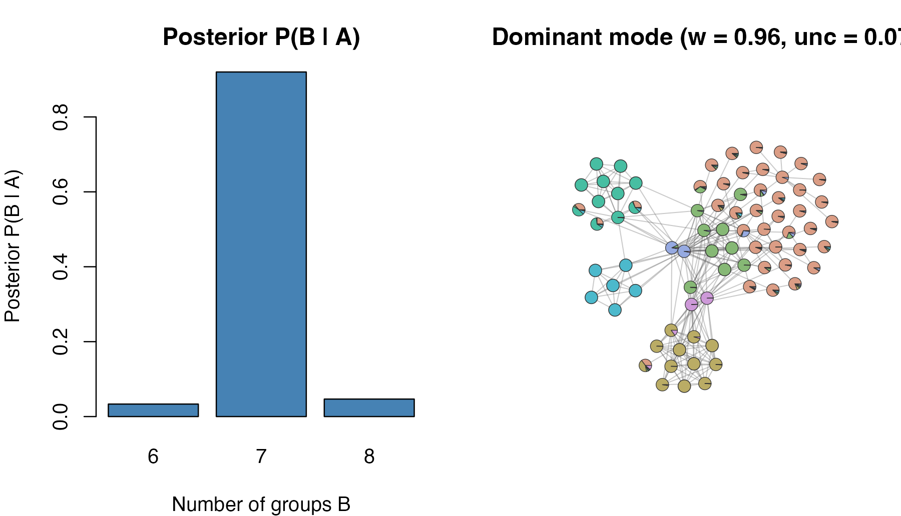
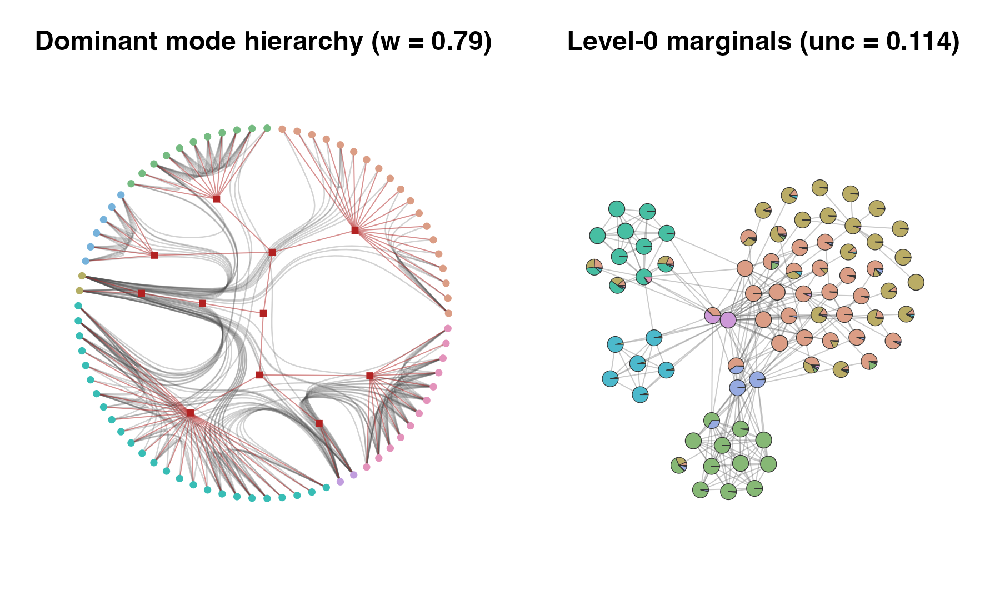

# Posterior MCMC Sampling & Partition Modes

This article corresponds to the `posterior_sampling` and
`hierarchical_sampling` demos. Rather than relying on a single point
estimate of the community partition, `rgraphtool` samples directly from
the exact Bayesian posterior \\P(b \mid A) \propto \exp(-\Sigma(A, b))\\
using merge-split MCMC and summarizes multimodal posteriors through
optimal label alignment and mode clustering.

## 1. Flat posterior sampling, vertex marginals, and mode clustering

Starting from a multilevel point estimate,
[`mcmc_equilibrate()`](https://diogro.github.io/rgraphtool/reference/mcmc_sweep.md)
runs merge-split MCMC until the description length reaches stationarity,
after which
[`sample_posterior()`](https://diogro.github.io/rgraphtool/reference/mcmc_sweep.md)
draws thinned posterior partitions.

``` r

lesmis <- load_or_fallback_lesmis()
g <- lesmis$graph

set.seed(42)
state <- minimize_blockmodel_dl(g)
eq <- mcmc_equilibrate(state, wait = 100L, nbreaks = 2L,
                       mcmc_args = list(niter = 10L))
cat(sprintf("Equilibrated flat DC SBM in %d steps (DL = %.2f nats)\n",
            eq$niter, eq$entropy))
#> Equilibrated flat DC SBM in 306 steps (DL = 711.65 nats)

post <- sample_posterior(eq$state, nsamples = 300L, thin = 8L, burnin = 0L)

# Posterior distribution over the number of groups B
B_samples <- vapply(post$samples, function(b) max(b), integer(1L))
B_dist <- prop.table(table(B_samples))
round(B_dist, 3)
#> B_samples
#>     6     7     8 
#> 0.033 0.920 0.047

# Single-mode optimal label alignment and multimodal clustering
pm <- partition_mode_state(post)
print(pm)
#> <partition mode: M = 300, B = 10, uncertainty = 0.0847, DL = 9697.2738 nats>

mc <- mode_cluster_state(post)
print(mc)
#> <flat mode cluster state: K = 2 modes (Be = 1.18), M = 300 partitions, DL = 9226.1196 nats>
#>  mode   M weight B uncertainty posterior_entropy description_length
#>     1 288   0.96 8  0.07805736          20.98771           8130.134
#>     2  12   0.04 8  0.12229437          21.89292           1036.346

old_par <- graphics::par(mfrow = c(1L, 2L), mar = c(4, 4, 3, 1))
graphics::barplot(B_dist, xlab = "Number of groups B", ylab = "Posterior P(B | A)",
                  col = "steelblue", main = "Posterior P(B | A)")

dom <- mc$modes[[1L]]
plot_marginals(g, dom, positions = lesmis$positions, radius = 0.045,
               main = sprintf("Dominant mode (w = %.2f, unc = %.3f)",
                              mc$weights[1L], mode_uncertainty(dom)))
```



``` r

graphics::par(old_par)
```

## 2. Hierarchical posterior sampling and consensus hierarchies

The exact same workflow extends to nested SBMs, capturing uncertainty in
both level-0 memberships and the depth and branching structure of the
hierarchy.

``` r

set.seed(42)
nstate <- minimize_nested_blockmodel_dl(g)
print(nstate)
#> <nested block state: degree-corrected, 8 levels, description length 702.9242 nats>
#> l: 0, N: 77, B: 6
#> l: 1, N: 6, B: 1
#> l: 2, N: 1, B: 1

npost <- sample_posterior(nstate, nsamples = 250L, thin = 5L,
                          equilibrate_args = list(wait = 100L, nbreaks = 2L))

B0 <- vapply(npost$samples, function(bs) max(bs[[1L]]), integer(1L))
depth <- vapply(npost$samples, function(bs) {
  top <- match(1L, vapply(bs, max, integer(1L)))
  if (is.na(top)) length(bs) else top
}, integer(1L))

round(prop.table(table(B0)), 3)
#> B0
#>     5     6     7     8 
#> 0.008 0.084 0.740 0.168
round(prop.table(table(depth)), 3)
#> depth
#>     2     3     4     5     6     7 
#> 0.092 0.556 0.252 0.080 0.016 0.004

nmc <- mode_cluster_state(npost)
print(nmc)
#> <nested mode cluster state: K = 2 modes (Be = 1.68), M = 250 partitions, DL = 11994.8425 nats>
#>  mode   M weight B uncertainty posterior_entropy description_length
#>     1 197  0.788 8   0.1136528          35.85975           8494.971
#>     2  53  0.212 8   0.1362411          38.57326           3362.471

# Reconstruct a clean consensus hierarchy from the dominant posterior mode
dom_n <- nmc$modes[[1L]]
cons_levels <- mode_consensus(dom_n)
clean <- list()
used <- NULL
for (l in seq_along(cons_levels)) {
  b <- cons_levels[[l]]
  if (l > 1L) b <- b[used]
  b[is.na(b)] <- 1L
  used <- unique(b)
  clean[[l]] <- match(b, used)
  if (length(used) == 1L) break
}
cons_state <- nested_block_state(g, clean, degree_corrected = TRUE)

old_par <- graphics::par(mfrow = c(1L, 2L), mar = c(2, 2, 3, 1))
plot_hierarchy(cons_state,
               main = sprintf("Dominant mode hierarchy (w = %.2f)", nmc$weights[1L]))
plot_marginals(g, dom_n, positions = lesmis$positions, radius = 0.045,
               main = sprintf("Level-0 marginals (unc = %.3f)",
                              mode_uncertainty(dom_n)))
```



``` r

graphics::par(old_par)
```
