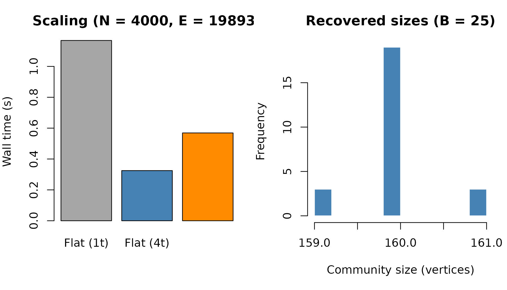

# Large-Network Parallelism & Native C++ Extensions

This article combines the `large_networks` and `cpp_extensions` demos,
covering multi-threaded SBM inference on large graphs and writing custom
C++ network algorithms directly against `rgraphtool`’s public
`<rgraphtool.h>` header interface.

## 1. Scalable, multi-threaded SBM inference

For large graphs (\\(N \ge 10^4\\)), `rgraphtool` provides a portable
C++23 `std::thread` pool
([`rgraphtool_set_num_threads()`](https://diogro.github.io/rgraphtool/reference/rgraphtool_threads.md)),
strictly agglomerative search
(`control = list(bisection = FALSE, r = 0.5)`), hierarchy-shape
initialization (`simple_init = TRUE`), and warm-starting
(`init_levels`).

\
[`set.seed`](https://rdrr.io/r/base/Random.html)`(``42``)`\
`n`` ``<-`` ``4000L`\
`B_true`` ``<-`` ``25L`\
`k_avg`` ``<-`` ``10`\
`sz`` ``<-`` ``n`` `[`%/%`](https://rdrr.io/r/base/Arithmetic.html)` ``B_true`\
`m_in`` ``<-`` `[`as.integer`](https://rdrr.io/r/base/integer.html)`(`[`round`](https://rdrr.io/r/base/Round.html)`(``n`` ``*`` ``k_avg`` ``*`` ``0.42``)``)`\
`m_out`` ``<-`` `[`as.integer`](https://rdrr.io/r/base/integer.html)`(`[`round`](https://rdrr.io/r/base/Round.html)`(``n`` ``*`` ``k_avg`` ``*`` ``0.08``)``)`\
`g_id`` ``<-`` `[`sample.int`](https://rdrr.io/r/base/sample.html)`(``B_true``, ``m_in``, replace ``=`` ``TRUE``)`\
`u_in`` ``<-`` ``(``g_id`` ``-`` ``1L``)`` ``*`` ``sz`` ``+`` `[`sample.int`](https://rdrr.io/r/base/sample.html)`(``sz``, ``m_in``, replace ``=`` ``TRUE``)`\
`v_in`` ``<-`` ``(``g_id`` ``-`` ``1L``)`` ``*`` ``sz`` ``+`` `[`sample.int`](https://rdrr.io/r/base/sample.html)`(``sz``, ``m_in``, replace ``=`` ``TRUE``)`\
`keep`` ``<-`` ``u_in`` ``!=`` ``v_in`` ``&`` ``u_in`` ``<=`` ``n`` ``&`` ``v_in`` ``<=`` ``n`\
`u_out`` ``<-`` `[`sample.int`](https://rdrr.io/r/base/sample.html)`(``n``, ``m_out``, replace ``=`` ``TRUE``)`\
`v_out`` ``<-`` `[`sample.int`](https://rdrr.io/r/base/sample.html)`(``n``, ``m_out``, replace ``=`` ``TRUE``)`\
`keep2`` ``<-`` ``u_out`` ``!=`` ``v_out`\
`edges`` ``<-`` `[`rbind`](https://rdrr.io/r/base/cbind.html)`(`[`cbind`](https://rdrr.io/r/base/cbind.html)`(``u_in``[``keep``]``, ``v_in``[``keep``]``)``, `[`cbind`](https://rdrr.io/r/base/cbind.html)`(``u_out``[``keep2``]``, ``v_out``[``keep2``]``)``)`\
`g_lg`` ``<-`` `[`graph_add_edges`](https://diogro.github.io/rgraphtool/reference/graph.md)`(`[`graph_create`](https://diogro.github.io/rgraphtool/reference/graph.md)`(``n``, directed ``=`` ``FALSE``)``, ``edges``)`\
`truth`` ``<-`` `[`rep`](https://rdrr.io/r/base/rep.html)`(`[`seq_len`](https://rdrr.io/r/base/seq.html)`(``B_true``)``, each ``=`` ``sz``)``[`[`seq_len`](https://rdrr.io/r/base/seq.html)`(``n``)``]`\
\
`nthr`` ``<-`` `[`min`](https://rdrr.io/r/base/Extremes.html)`(``4L``, `[`rgraphtool_max_threads`](https://diogro.github.io/rgraphtool/reference/rgraphtool_threads.md)`(``)``)`\
[`invisible`](https://rdrr.io/r/base/invisible.html)`(`[`block_description_length`](https://diogro.github.io/rgraphtool/reference/block_state.md)`(`[`block_state`](https://diogro.github.io/rgraphtool/reference/block_state.md)`(``g_lg``)``)``)`\
\
`# Strictly agglomerative flat SBM: 1 thread vs multi-threaded`\
[`set.seed`](https://rdrr.io/r/base/Random.html)`(``1``)`\
`t_flat_1t`` ``<-`` `[`system.time`](https://rdrr.io/r/base/system.time.html)`(`\
`  ``st_1t`` ``<-`` `[`minimize_blockmodel_dl`](https://diogro.github.io/rgraphtool/reference/minimize_blockmodel_dl.md)`(``g_lg``, nthreads ``=`` ``1L``,`\
`                                  control ``=`` `[`list`](https://rdrr.io/r/base/list.html)`(``bisection ``=`` ``FALSE``, r ``=`` ``0.5``)``)`\
`)``[``3L``]`\
\
[`set.seed`](https://rdrr.io/r/base/Random.html)`(``1``)`\
`t_flat_mt`` ``<-`` `[`system.time`](https://rdrr.io/r/base/system.time.html)`(`\
`  ``st_mt`` ``<-`` `[`minimize_blockmodel_dl`](https://diogro.github.io/rgraphtool/reference/minimize_blockmodel_dl.md)`(``g_lg``, nthreads ``=`` ``nthr``,`\
`                                  control ``=`` `[`list`](https://rdrr.io/r/base/list.html)`(``bisection ``=`` ``FALSE``, r ``=`` ``0.5``)``)`\
`)``[``3L``]`\
\
`# Nested SBM with simple_init`\
[`set.seed`](https://rdrr.io/r/base/Random.html)`(``1``)`\
`t_nest_mt`` ``<-`` `[`system.time`](https://rdrr.io/r/base/system.time.html)`(`\
`  ``nst_mt`` ``<-`` `[`minimize_nested_blockmodel_dl`](https://diogro.github.io/rgraphtool/reference/minimize_nested_blockmodel_dl.md)`(`\
`    ``g_lg``, simple_init ``=`` ``TRUE``, B_min_base ``=`` ``100L``,`\
`    nthreads ``=`` ``nthr``, control ``=`` `[`list`](https://rdrr.io/r/base/list.html)`(``r ``=`` ``0.5``)`\
`  ``)`\
`)``[``3L``]`\
\
[`cat`](https://rdrr.io/r/base/cat.html)`(`[`sprintf`](https://rdrr.io/r/base/sprintf.html)`(`\
`  ``"Flat (1 thr): %.3f s | Flat (%d thr): %.3f s (%.2fx) | overlap = %.4f\n"``,`\
`  ``t_flat_1t``, ``nthr``, ``t_flat_mt``, ``t_flat_1t`` ``/`` `[`max`](https://rdrr.io/r/base/Extremes.html)`(``t_flat_mt``, ``1e-6``)``,`\
`  `[`partition_overlap`](https://diogro.github.io/rgraphtool/reference/partition_mode_state.md)`(`[`block_membership`](https://diogro.github.io/rgraphtool/reference/block_state.md)`(``st_mt``)``, ``truth``, norm ``=`` ``TRUE``)`\
`)``)`\
`#> Flat (1 thr): 1.168 s | Flat (4 thr): 0.325 s (3.59x) | overlap = 0.9992`\
[`cat`](https://rdrr.io/r/base/cat.html)`(`[`sprintf`](https://rdrr.io/r/base/sprintf.html)`(`\
`  ``"Nested simple_init (%d thr): %.3f s | B0 = %d | overlap = %.4f\n"``,`\
`  ``nthr``, ``t_nest_mt``, `[`max`](https://rdrr.io/r/base/Extremes.html)`(`[`nested_levels`](https://diogro.github.io/rgraphtool/reference/minimize_nested_blockmodel_dl.md)`(``nst_mt``)``[[``1L``]``]``)``,`\
`  `[`partition_overlap`](https://diogro.github.io/rgraphtool/reference/partition_mode_state.md)`(`[`nested_levels`](https://diogro.github.io/rgraphtool/reference/minimize_nested_blockmodel_dl.md)`(``nst_mt``)``[[``1L``]``]``, ``truth``, norm ``=`` ``TRUE``)`\
`)``)`\
`#> Nested simple_init (4 thr): 0.569 s | B0 = 26 | overlap = 0.9805`\
\
`old_par`` ``<-`` ``graphics``::`[`par`](https://rdrr.io/r/graphics/par.html)`(``mfrow ``=`` `[`c`](https://rdrr.io/r/base/c.html)`(``1L``, ``2L``)``, mar ``=`` `[`c`](https://rdrr.io/r/base/c.html)`(``5``, ``4``, ``3``, ``1``)``)`\
`graphics``::`[`barplot`](https://rdrr.io/r/graphics/barplot.html)`(`\
`  `[`c`](https://rdrr.io/r/base/c.html)`(``t_flat_1t``, ``t_flat_mt``, ``t_nest_mt``)``,`\
`  names.arg ``=`` `[`c`](https://rdrr.io/r/base/c.html)`(``"Flat (1t)"``, `[`sprintf`](https://rdrr.io/r/base/sprintf.html)`(``"Flat (%dt)"``, ``nthr``)``, `[`sprintf`](https://rdrr.io/r/base/sprintf.html)`(``"Nested (%dt)"``, ``nthr``)``)``,`\
`  ylab ``=`` ``"Wall time (s)"``,`\
`  col ``=`` `[`c`](https://rdrr.io/r/base/c.html)`(``"grey65"``, ``"steelblue"``, ``"darkorange"``)``,`\
`  main ``=`` `[`sprintf`](https://rdrr.io/r/base/sprintf.html)`(``"Scaling (N = %d, E = %d)"``, ``n``, `[`graph_num_edges`](https://diogro.github.io/rgraphtool/reference/graph.md)`(``g_lg``)``)`\
`)`\
`graphics``::`[`hist`](https://rdrr.io/r/graphics/hist.html)`(`\
`  `[`block_sizes`](https://diogro.github.io/rgraphtool/reference/block_state.md)`(``st_mt``)``, breaks ``=`` ``12``, col ``=`` ``"steelblue"``, border ``=`` ``"white"``,`\
`  xlab ``=`` ``"Community size (vertices)"``,`\
`  main ``=`` `[`sprintf`](https://rdrr.io/r/base/sprintf.html)`(``"Recovered sizes (B = %d)"``, `[`length`](https://rdrr.io/r/base/length.html)`(`[`block_sizes`](https://diogro.github.io/rgraphtool/reference/block_state.md)`(``st_mt``)``)``)`\
`)`

\
`graphics``::`[`par`](https://rdrr.io/r/graphics/par.html)`(``old_par``)`

## 2. Writing native C++ extensions with `<rgraphtool.h>`

Downstream R packages (`LinkingTo: rgraphtool, Rcpp, BH` and
`CXX_STD = CXX23`) or interactive
[`Rcpp::sourceCpp()`](https://rdrr.io/pkg/Rcpp/man/sourceCpp.html)
scripts can `#include <rgraphtool.h>` to get zero-copy access to
`rgraphtool::Graph`, range-based iteration (`vertices_range`,
`edges_range`, `out_edges_range`, `all_neighbors_range`), and
vertex/edge property maps with bounds-checked defaults and
upfront-validated raw-pointer views via `.get_unchecked()`.

`rgraphtool` ships with built-in reference implementations
([`kcore_decomposition()`](https://diogro.github.io/rgraphtool/reference/cpp_extensions.md),
[`vertex_strength()`](https://diogro.github.io/rgraphtool/reference/cpp_extensions.md))
as well as ready-to-compile standalone `.cpp` examples discoverable via
[`rgraphtool_extension_example()`](https://diogro.github.io/rgraphtool/reference/cpp_extensions.md).

\
[`set.seed`](https://rdrr.io/r/base/Random.html)`(``2026``)`\
`n_ext`` ``<-`` ``1500L`\
`u`` ``<-`` `[`sample.int`](https://rdrr.io/r/base/sample.html)`(``n_ext``, ``7500L``, replace ``=`` ``TRUE``)`\
`v`` ``<-`` `[`sample.int`](https://rdrr.io/r/base/sample.html)`(``n_ext``, ``7500L``, replace ``=`` ``TRUE``)`\
`kp`` ``<-`` ``u`` ``!=`` ``v`\
`g_ext`` ``<-`` `[`graph_create`](https://diogro.github.io/rgraphtool/reference/graph.md)`(``n_ext``, directed ``=`` ``FALSE``)`\
[`graph_add_edges`](https://diogro.github.io/rgraphtool/reference/graph.md)`(``g_ext``, `[`cbind`](https://rdrr.io/r/base/cbind.html)`(``u``[``kp``]``, ``v``[``kp``]``)``,`\
`                properties ``=`` `[`list`](https://rdrr.io/r/base/list.html)`(``weight ``=`` ``stats``::`[`rexp`](https://rdrr.io/r/stats/Exponential.html)`(`[`sum`](https://rdrr.io/r/base/sum.html)`(``kp``)``, rate ``=`` ``1.0``)``)``)`\
\
`# Live-compile the bundled k-core and weighted-strength C++ extensions`\
`ext_env`` ``<-`` `[`new.env`](https://rdrr.io/r/base/environment.html)`(``parent ``=`` `[`globalenv`](https://rdrr.io/r/base/environment.html)`(``)``)`\
[`compile_cpp_extension`](https://diogro.github.io/rgraphtool/reference/cpp_extensions.md)`(``file ``=`` `[`rgraphtool_extension_example`](https://diogro.github.io/rgraphtool/reference/cpp_extensions.md)`(``"kcore"``)``, env ``=`` ``ext_env``)`\
[`compile_cpp_extension`](https://diogro.github.io/rgraphtool/reference/cpp_extensions.md)`(``file ``=`` `[`rgraphtool_extension_example`](https://diogro.github.io/rgraphtool/reference/cpp_extensions.md)`(``"weighted_degree"``)``, env ``=`` ``ext_env``)`\
\
`kc_ext`` ``<-`` ``ext_env``$``ext_kcore_decomposition``(``g_ext``, checked ``=`` ``FALSE``)`\
[`stopifnot`](https://rdrr.io/r/base/stopifnot.html)`(`[`identical`](https://rdrr.io/r/base/identical.html)`(``kc_ext``, `[`kcore_decomposition`](https://diogro.github.io/rgraphtool/reference/cpp_extensions.md)`(``g_ext``, checked ``=`` ``FALSE``)``)``)`\
\
`ws_ext`` ``<-`` ``ext_env``$``ext_weighted_strength``(``g_ext``, ``"weight"``, checked ``=`` ``FALSE``)`\
[`stopifnot`](https://rdrr.io/r/base/stopifnot.html)`(`[`max`](https://rdrr.io/r/base/Extremes.html)`(`[`abs`](https://rdrr.io/r/base/MathFun.html)`(``ws_ext`` ``-`` `[`vertex_strength`](https://diogro.github.io/rgraphtool/reference/cpp_extensions.md)`(``g_ext``, ``"weight"``)``)``)`` ``<`` ``1e-12``)`\
\
`# Benchmark checked vs. unchecked property map access (50 passes)`\
`t_chk`` ``<-`` `[`system.time`](https://rdrr.io/r/base/system.time.html)`(`\
`  ``for`` ``(``i`` ``in`` `[`seq_len`](https://rdrr.io/r/base/seq.html)`(``50L``)``)`` ``ext_env``$``ext_kcore_decomposition``(``g_ext``, checked ``=`` ``TRUE``)`\
`)``[``3L``]`\
`t_uchk`` ``<-`` `[`system.time`](https://rdrr.io/r/base/system.time.html)`(`\
`  ``for`` ``(``i`` ``in`` `[`seq_len`](https://rdrr.io/r/base/seq.html)`(``50L``)``)`` ``ext_env``$``ext_kcore_decomposition``(``g_ext``, checked ``=`` ``FALSE``)`\
`)``[``3L``]`\
[`cat`](https://rdrr.io/r/base/cat.html)`(`[`sprintf`](https://rdrr.io/r/base/sprintf.html)`(``"50 x k-core (N=%d, E=%d): checked = %.4f s | unchecked = %.4f s\n"``,`\
`            ``n_ext``, `[`graph_num_edges`](https://diogro.github.io/rgraphtool/reference/graph.md)`(``g_ext``)``, ``t_chk``, ``t_uchk``)``)`\
`#> 50 x k-core (N=1500, E=7497): checked = 0.0340 s | unchecked = 0.0110 s`

You can also compile inline C++ code directly with
`compile_cpp_extension(code = ...)`:

\
`inline_cpp`` ``<-`` ``'`\
`#include <rgraphtool.h>`\
\
`// [[Rcpp::export]]`\
`Rcpp::NumericVector ext_avg_incident_weight(SEXP graph, std::string prop = "weight") {`\
`    const rgraphtool::Graph& g = rgraphtool::get_graph(graph);`\
`    Rcpp::NumericVector out(static_cast<R_xlen_t>(rgraphtool::num_vertices(g)), 0.0);`\
`    auto out_u = rgraphtool::vertex_property_view(out, g).get_unchecked();`\
`    auto w_u = rgraphtool::edge_property_view(g, prop).get_unchecked();`\
\
`    for (auto v : rgraphtool::vertices_range(g)) {`\
`        double sum_w = 0.0;`\
`        size_t cnt = 0;`\
`        for (const auto& e : rgraphtool::out_edges_range(v, g)) {`\
`            sum_w += w_u[e];`\
`            ++cnt;`\
`        }`\
`        out_u[v] = (cnt > 0) ? (sum_w / static_cast<double>(cnt)) : 0.0;`\
`    }`\
`    return out;`\
`}`\
`'`\
[`compile_cpp_extension`](https://diogro.github.io/rgraphtool/reference/cpp_extensions.md)`(``code ``=`` ``inline_cpp``, env ``=`` ``ext_env``)`\
[`summary`](https://rdrr.io/r/base/summary.html)`(``ext_env``$``ext_avg_incident_weight``(``g_ext``, ``"weight"``)``)`\
`#>    Min. 1st Qu.  Median    Mean 3rd Qu.    Max. `\
`#>  0.2661  0.7577  0.9635  0.9982  1.1857  2.6405`
