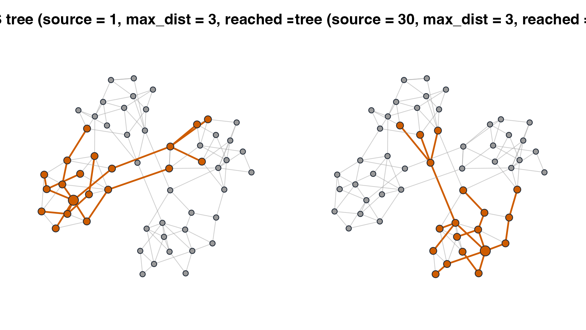
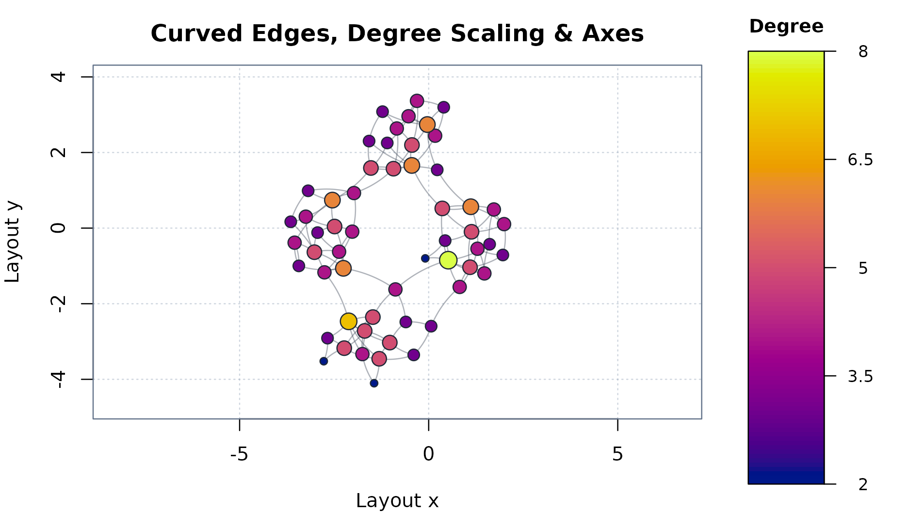
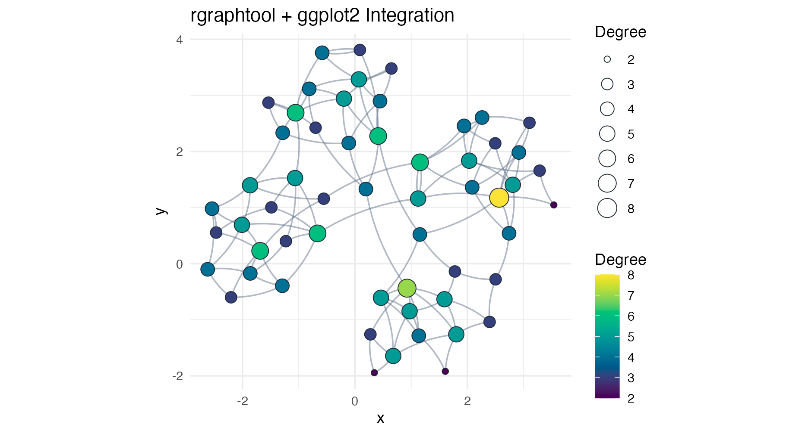
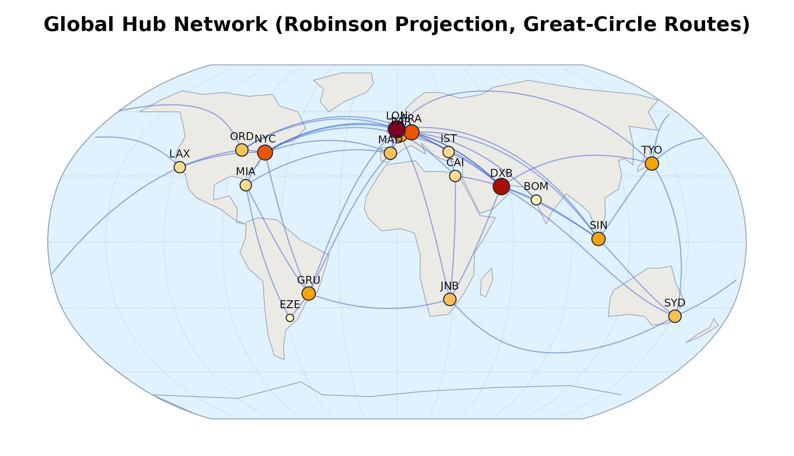

# Layouts, Animations, Plotting Integration & Geographic Maps

This article brings together five visualization demos (`animation_sirs`,
`animation_dynamic_layout`, `interactive_bfs`, `plotting_integration`,
and `plotting_map`), showing how `rgraphtool` delivers force-directed
layouts, interactive HTML5 Canvas animations, `grid`/`ggplot2`
integration, vector and raster export, and offline geographic network
maps with zero Python or GIS dependencies.

## 1. SIRS epidemic waves & fear-state animation

[`animate_sirs()`](https://diogro.github.io/rgraphtool/reference/animate_sirs.md)
runs asynchronous random-order SIRS updates natively in C++, supporting
recovered-vertex hiding (`hide_recovered = TRUE`), red halos on newly
infected nodes, and a susceptible-near-infected “fear” visual state
(`fear_state = TRUE`). Pass `mode = "html"` (with `open = TRUE`
interactively) for a self-contained HTML5 Canvas animation player, or
`mode = "frames"` to export numbered PNG frames.

``` r

set.seed(42)
n <- 90L
pts <- cbind(x = stats::runif(n), y = stats::runif(n))
dmat <- as.matrix(stats::dist(pts))
diag(dmat) <- Inf
edge_pairs <- unique(do.call(rbind, lapply(seq_len(n), function(i) {
  nbrs <- order(dmat[i, ])[seq_len(5L)]
  cbind(pmin(i, nbrs), pmax(i, nbrs))
})))
g_sirs <- graph_add_edges(graph_create(n, directed = FALSE), edge_pairs)
pos_sirs <- sfdp_layout(g_sirs, pos = pts, K = 0.25, max_iter = 60L)

init_s <- integer(n)
init_s[c(1L, 30L, 60L)] <- 1L
anim <- animate_sirs(
  g_sirs, pos = pos_sirs, n_steps = 60L,
  x = 0.002, r = 0.12, s = 0.02,
  init_state = init_s, hide_recovered = TRUE, fear_state = TRUE,
  mode = "html", output = tempfile(fileext = ".html")
)
print(anim)
#> rgraphtool SIRS epidemic animation
#>   vertices: 90 | frames: 61 (steps = 60)
#>   rates: x = 0.002, r = 0.12, s = 0.02 | hide_recovered = TRUE | fear_state = TRUE
#>   peak infected: 49 | total new infections: 113
#>   mode: html -> /var/folders/ph/fmqmjzln2h15bm5bstsgpng80000gn/T//RtmproOwVJ/file173bf4e3f6a6a.html

# Render an epidemic curve alongside a mid-outbreak snapshot
peak_t <- which.max(anim$counts[, "I"])
st_p <- anim$states[, peak_t]
v_col <- ifelse(st_p == 1L, "#111827", ifelse(st_p == 2L, "#CBD5E1", "#3B82F6"))
v_col[anim$fear[, peak_t] & st_p == 0L] <- "#F59E0B"

old_par <- graphics::par(mfrow = c(1L, 2L), mar = c(4, 4, 3, 1))
graphics::matplot(0:60, anim$counts, type = "l", lwd = 2, lty = 1,
                  col = c("#3B82F6", "#111827", "#94A3B8"),
                  xlab = "Step", ylab = "Vertices", main = "SIRS Epidemic Curve")
graphics::abline(v = peak_t - 1L, lty = 2, col = "#DC2626")
graphics::legend("topright", legend = c("S", "I", "R"),
                 col = c("#3B82F6", "#111827", "#94A3B8"), lwd = 2, bty = "n")

plot_graph(g_sirs, pos = pos_sirs, vertex_color = v_col,
           vertex_halo = anim$newly_infected[, peak_t],
           vertex_visible = st_p != 2L,
           main = sprintf("Peak outbreak (step %d, I = %d)",
                          peak_t - 1L, anim$counts[peak_t, "I"]))
```


``` r

graphics::par(old_par)
```

## 2. Dynamic force-directed layout & spatial segregation

[`animate_dynamic_layout()`](https://diogro.github.io/rgraphtool/reference/animate_sirs.md)
alternates incremental `sfdp_layout(..., max_iter = 1L)` updates with
distance-shortening edge rewirings natively in C++, preserving edge
count and connectivity while self-organizing into spatially localized
clusters.

``` r

set.seed(2026)
n_d <- 70L
ring <- cbind(seq_len(n_d), c(seq_len(n_d - 1L) + 1L, 1L))
chords <- cbind(sample.int(n_d, 100L, replace = TRUE),
                sample.int(n_d, 100L, replace = TRUE))
chords <- chords[chords[, 1L] != chords[, 2L], , drop = FALSE]
g_dyn <- graph_add_edges(
  graph_create(n_d, directed = FALSE),
  unique(rbind(ring, cbind(pmin(chords[, 1L], chords[, 2L]),
                           pmax(chords[, 1L], chords[, 2L]))))
)
pos0 <- sfdp_layout(g_dyn, K = 0.5, max_iter = 60L)
dyn <- animate_dynamic_layout(
  g_dyn, pos = pos0, n_steps = 70L, K = 0.5, step = 0.005, n_rewire = 25L,
  mode = "none"
)
print(dyn)
#> rgraphtool dynamic layout animation
#>   vertices: 70 | edges: 165 | frames: 71
#>   mean edge length: 0.5660 -> 0.4268 | total rewirings: 136
#>   mode: none

old_par <- graphics::par(mfrow = c(1L, 2L), mar = c(4, 4, 3, 1))
graphics::plot(0:70, dyn$mean_edge_length, type = "l", lwd = 2, col = "#2563EB",
               xlab = "Step", ylab = "Mean Euclidean edge length",
               main = "Spatial segregation contraction")
g_end <- graph_add_edges(graph_create(n_d, directed = FALSE), dyn$edges[[71L]])
plot_graph(g_end, pos = dyn$positions[[71L]], vertex_color = "#2563EB",
           vertex_size = 1.0, main = "Final rewired layout (step 70)")
```


``` r

graphics::par(old_par)
```

## 3. Interactive BFS shortest-path tree explorer

[`interactive_bfs()`](https://diogro.github.io/rgraphtool/reference/interactive_bfs.md)
generates an interactive HTML5 Canvas explorer (`mode = "html"`, hover
or click any vertex to highlight its depth-\\d\\ BFS tree), a base-R
click loop (`mode = "locator"`), or multi-root static snapshots
(`mode = "snapshot"`).

``` r

set.seed(7)
n_grp <- 4L
gsz <- 14L
n_bfs <- n_grp * gsz
grp <- rep(seq_len(n_grp), each = gsz)
el_b <- list()
for (k in seq_len(n_grp)) {
  nd <- which(grp == k)
  el_b[[length(el_b) + 1L]] <- cbind(nd, c(nd[-1L], nd[1L]))
  for (i in seq_len(gsz - 1L)) {
    for (j in (i + 1L):gsz) {
      if (stats::runif(1L) < 0.22) el_b[[length(el_b) + 1L]] <- cbind(nd[i], nd[j])
    }
  }
  k2 <- if (k < n_grp) k + 1L else 1L
  el_b[[length(el_b) + 1L]] <- cbind(sample(nd, 2L), sample(which(grp == k2), 2L))
}
g_bfs <- graph_add_edges(graph_create(n_bfs, directed = FALSE), unique(do.call(rbind, el_b)))
pos_bfs <- sfdp_layout(g_bfs, groups = grp, mu = 0.35, max_iter = 80L)

interactive_bfs(g_bfs, pos = pos_bfs, source = c(1L, 30L), max_dist = 3L,
                mode = "snapshot", main = "BFS tree")
```



    #> rgraphtool interactive BFS visualization
    #>   mode: snapshot
    #> rgraphtool BFS traversal
    #>   source: 30 (undirected, max_dist = 3)
    #>   reached: 19 / 56 vertices (max distance = 3, tree edges = 18)

## 4. Multi-panel plotting, colorbars, `grid` grobs, and `ggplot2`

[`prop_to_size()`](https://diogro.github.io/rgraphtool/reference/plotting_integration.md),
[`map_colors()`](https://diogro.github.io/rgraphtool/reference/plotting_integration.md),
[`plot_colorbar()`](https://diogro.github.io/rgraphtool/reference/plotting_integration.md),
[`save_graph_plot()`](https://diogro.github.io/rgraphtool/reference/plotting_integration.md),
[`graph_grob()`](https://diogro.github.io/rgraphtool/reference/plotting_integration.md),
and
[`ggplot_graph()`](https://diogro.github.io/rgraphtool/reference/plotting_integration.md)
integrate `rgraphtool` into base R, `grid`, and `ggplot2` figures with
vector (PDF, SVG, EPS) and raster (PNG, JPEG, TIFF) export.

``` r

deg <- graph_degree(g_bfs)
vcol <- map_colors(deg, palette = "Plasma")
vsiz <- prop_to_size(deg, mi = 0.85, ma = 2.0, power = 0.5)

graphics::layout(matrix(c(1L, 2L), nrow = 1L), widths = c(4.5, 1.1))
plot_graph(g_bfs, pos = pos_bfs, vertex_color = vcol, vertex_size = vsiz,
           vorder = deg, edge_curve = 0.12, axes = TRUE, grid_lines = TRUE,
           xlab = "Layout x", ylab = "Layout y",
           main = "Curved Edges, Degree Scaling & Axes")
plot_colorbar(vcol, title = "Degree")
```



``` r

graphics::layout(1L)
```

``` r

if (requireNamespace("ggplot2", quietly = TRUE)) {
  ggplot_graph(
    g_bfs, pos = pos_bfs,
    vertex_color = deg, vertex_size = deg,
    edge_curve = 0.12, axes = TRUE, palette = "Viridis",
    color_label = "Degree", size_label = "Degree",
    main = "rgraphtool + ggplot2 Integration"
  )
}
```



## 5. Offline geographic network maps

[`plot_graph_map()`](https://diogro.github.io/rgraphtool/reference/plot_graph_map.md)
projects spatial networks onto built-in offline world coastlines using
Robinson, Mercator, equirectangular, Mollweide, or orthographic
projections with spherical great-circle geodesic arcs that split cleanly
across the antimeridian.

``` r

cities <- data.frame(
  code = c("NYC", "LAX", "ORD", "MIA", "GRU", "EZE",
           "LON", "PAR", "FRA", "MAD", "IST", "CAI",
           "JNB", "DXB", "BOM", "SIN", "TYO", "SYD"),
  lon = c(-74.0, -118.2, -87.6, -80.2, -46.6, -58.4,
          -0.1,   2.35,   8.68, -3.70, 28.98, 31.24,
          28.05,  55.27,  72.88, 103.82, 139.69, 151.21),
  lat = c( 40.7,  34.0,  41.9,  25.8, -23.5, -34.6,
           51.5,  48.9,  50.1,  40.4,  41.0,  30.0,
          -26.2,  25.2,  19.1,   1.35,  35.68, -33.87),
  stringsAsFactors = FALSE
)
routes <- rbind(
  c(1, 2), c(1, 3), c(1, 4), c(1, 5), c(1, 7), c(1, 8), c(1, 9), c(1, 10),
  c(2, 3), c(2, 17), c(2, 18), c(3, 7), c(3, 9), c(3, 17),
  c(4, 5), c(4, 6), c(4, 10), c(5, 6), c(5, 7), c(5, 10), c(5, 13),
  c(7, 8), c(7, 9), c(7, 10), c(7, 11), c(7, 13), c(7, 14), c(7, 16), c(7, 17),
  c(8, 9), c(8, 10), c(8, 12), c(8, 14), c(9, 11), c(9, 14), c(9, 15), c(9, 16),
  c(11, 12), c(11, 14), c(12, 13), c(12, 14), c(13, 14), c(13, 18),
  c(14, 15), c(14, 16), c(14, 17), c(14, 18),
  c(15, 16), c(16, 17), c(16, 18), c(17, 18)
)
g_air <- graph_add_edges(graph_create(nrow(cities), directed = FALSE), routes)
air_deg <- graph_degree(g_air)

plot_graph_map(
  g_air, lon = cities$lon, lat = cities$lat,
  projection = "robinson", geodesic = TRUE,
  vertex_color = map_colors(air_deg, palette = "YlOrRd", rev = TRUE),
  vertex_size = prop_to_size(air_deg, mi = 1.0, ma = 2.3, power = 0.6),
  vorder = air_deg,
  vertex_label = cities$code, vertex_label_cex = 0.65,
  edge_color = grDevices::adjustcolor("#1D4ED8", 0.45),
  main = "Global Hub Network (Robinson Projection, Great-Circle Routes)"
)
```


