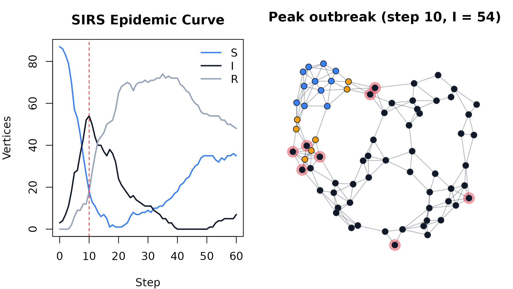
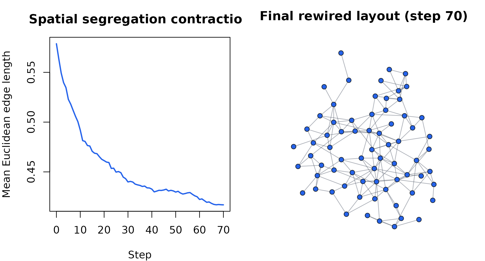

# Layouts, Animations, Plotting Integration & Geographic Maps

This article brings together five visualization demos (`animation_sirs`,
`animation_dynamic_layout`, `interactive_bfs`, `plotting_integration`,
and `plotting_map`), showing how `rgraphtool` delivers force-directed
layouts, interactive HTML5 Canvas animations, `grid`/`ggplot2`
integration, vector and raster export, and offline geographic network
maps with zero Python or GIS dependencies.

## 1. SIRS epidemic waves & fear-state animation

[`animate_sirs()`](https://diogro.github.io/rgraphtool/reference/animate_sirs.md)
runs asynchronous random-order SIRS updates natively in C++, supporting
recovered-vertex hiding (`hide_recovered = TRUE`), red halos on newly
infected nodes, and a susceptible-near-infected “fear” visual state
(`fear_state = TRUE`). Pass `mode = "html"` (with `open = TRUE`
interactively) for a self-contained HTML5 Canvas animation player, or
`mode = "frames"` to export numbered PNG frames.

\
[`set.seed`](https://rdrr.io/r/base/Random.html)`(``42``)`\
`n`` ``<-`` ``90L`\
`pts`` ``<-`` `[`cbind`](https://rdrr.io/r/base/cbind.html)`(``x ``=`` ``stats``::`[`runif`](https://rdrr.io/r/stats/Uniform.html)`(``n``)``, y ``=`` ``stats``::`[`runif`](https://rdrr.io/r/stats/Uniform.html)`(``n``)``)`\
`dmat`` ``<-`` `[`as.matrix`](https://rdrr.io/r/base/matrix.html)`(``stats``::`[`dist`](https://rdrr.io/r/stats/dist.html)`(``pts``)``)`\
[`diag`](https://rdrr.io/r/base/diag.html)`(``dmat``)`` ``<-`` ``Inf`\
`edge_pairs`` ``<-`` `[`unique`](https://rdrr.io/r/base/unique.html)`(`[`do.call`](https://rdrr.io/r/base/do.call.html)`(``rbind``, `[`lapply`](https://rdrr.io/r/base/lapply.html)`(`[`seq_len`](https://rdrr.io/r/base/seq.html)`(``n``)``, ``function``(``i``)`` ``{`\
`  ``nbrs`` ``<-`` `[`order`](https://rdrr.io/r/base/order.html)`(``dmat``[``i``, ``]``)``[`[`seq_len`](https://rdrr.io/r/base/seq.html)`(``5L``)``]`\
`  `[`cbind`](https://rdrr.io/r/base/cbind.html)`(`[`pmin`](https://rdrr.io/r/base/Extremes.html)`(``i``, ``nbrs``)``, `[`pmax`](https://rdrr.io/r/base/Extremes.html)`(``i``, ``nbrs``)``)`\
`}``)``)``)`\
`g_sirs`` ``<-`` `[`graph_add_edges`](https://diogro.github.io/rgraphtool/reference/graph.md)`(`[`graph_create`](https://diogro.github.io/rgraphtool/reference/graph.md)`(``n``, directed ``=`` ``FALSE``)``, ``edge_pairs``)`\
`pos_sirs`` ``<-`` `[`sfdp_layout`](https://diogro.github.io/rgraphtool/reference/sfdp_layout.md)`(``g_sirs``, pos ``=`` ``pts``, K ``=`` ``0.25``, max_iter ``=`` ``60L``)`\
\
`init_s`` ``<-`` `[`integer`](https://rdrr.io/r/base/integer.html)`(``n``)`\
`init_s``[`[`c`](https://rdrr.io/r/base/c.html)`(``1L``, ``30L``, ``60L``)``]`` ``<-`` ``1L`\
`anim`` ``<-`` `[`animate_sirs`](https://diogro.github.io/rgraphtool/reference/animate_sirs.md)`(`\
`  ``g_sirs``, pos ``=`` ``pos_sirs``, n_steps ``=`` ``60L``,`\
`  x ``=`` ``0.002``, r ``=`` ``0.12``, s ``=`` ``0.02``,`\
`  init_state ``=`` ``init_s``, hide_recovered ``=`` ``TRUE``, fear_state ``=`` ``TRUE``,`\
`  mode ``=`` ``"html"``, output ``=`` `[`tempfile`](https://rdrr.io/r/base/tempfile.html)`(``fileext ``=`` ``".html"``)`\
`)`\
[`print`](https://rdrr.io/r/base/print.html)`(``anim``)`\
`#> rgraphtool SIRS epidemic animation`\
`#>   vertices: 90 | frames: 61 (steps = 60)`\
`#>   rates: x = 0.002, r = 0.12, s = 0.02 | hide_recovered = TRUE | fear_state = TRUE`\
`#>   peak infected: 54 | total new infections: 106`\
`#>   mode: html -> /tmp/Rtmpr9zRS9/filedd56144417874.html`\
\
`# Render an epidemic curve alongside a mid-outbreak snapshot`\
`peak_t`` ``<-`` `[`which.max`](https://rdrr.io/r/base/which.min.html)`(``anim``$``counts``[``, ``"I"``]``)`\
`st_p`` ``<-`` ``anim``$``states``[``, ``peak_t``]`\
`v_col`` ``<-`` `[`ifelse`](https://rdrr.io/r/base/ifelse.html)`(``st_p`` ``==`` ``1L``, ``"#111827"``, `[`ifelse`](https://rdrr.io/r/base/ifelse.html)`(``st_p`` ``==`` ``2L``, ``"#CBD5E1"``, ``"#3B82F6"``)``)`\
`v_col``[``anim``$``fear``[``, ``peak_t``]`` ``&`` ``st_p`` ``==`` ``0L``]`` ``<-`` ``"#F59E0B"`\
\
`old_par`` ``<-`` ``graphics``::`[`par`](https://rdrr.io/r/graphics/par.html)`(``mfrow ``=`` `[`c`](https://rdrr.io/r/base/c.html)`(``1L``, ``2L``)``, mar ``=`` `[`c`](https://rdrr.io/r/base/c.html)`(``4``, ``4``, ``3``, ``1``)``)`\
`graphics``::`[`matplot`](https://rdrr.io/r/graphics/matplot.html)`(``0``:``60``, ``anim``$``counts``, type ``=`` ``"l"``, lwd ``=`` ``2``, lty ``=`` ``1``,`\
`                  col ``=`` `[`c`](https://rdrr.io/r/base/c.html)`(``"#3B82F6"``, ``"#111827"``, ``"#94A3B8"``)``,`\
`                  xlab ``=`` ``"Step"``, ylab ``=`` ``"Vertices"``, main ``=`` ``"SIRS Epidemic Curve"``)`\
`graphics``::`[`abline`](https://rdrr.io/r/graphics/abline.html)`(``v ``=`` ``peak_t`` ``-`` ``1L``, lty ``=`` ``2``, col ``=`` ``"#DC2626"``)`\
`graphics``::`[`legend`](https://rdrr.io/r/graphics/legend.html)`(``"topright"``, legend ``=`` `[`c`](https://rdrr.io/r/base/c.html)`(``"S"``, ``"I"``, ``"R"``)``,`\
`                 col ``=`` `[`c`](https://rdrr.io/r/base/c.html)`(``"#3B82F6"``, ``"#111827"``, ``"#94A3B8"``)``, lwd ``=`` ``2``, bty ``=`` ``"n"``)`\
\
[`plot_graph`](https://diogro.github.io/rgraphtool/reference/plot_graph.md)`(``g_sirs``, pos ``=`` ``pos_sirs``, vertex_color ``=`` ``v_col``,`\
`           vertex_halo ``=`` ``anim``$``newly_infected``[``, ``peak_t``]``,`\
`           vertex_visible ``=`` ``st_p`` ``!=`` ``2L``,`\
`           main ``=`` `[`sprintf`](https://rdrr.io/r/base/sprintf.html)`(``"Peak outbreak (step %d, I = %d)"``,`\
`                          ``peak_t`` ``-`` ``1L``, ``anim``$``counts``[``peak_t``, ``"I"``]``)``)`

\
`graphics``::`[`par`](https://rdrr.io/r/graphics/par.html)`(``old_par``)`

## 2. Dynamic force-directed layout & spatial segregation

[`animate_dynamic_layout()`](https://diogro.github.io/rgraphtool/reference/animate_sirs.md)
alternates incremental `sfdp_layout(..., max_iter = 1L)` updates with
distance-shortening edge rewirings natively in C++, preserving edge
count and connectivity while self-organizing into spatially localized
clusters.

\
[`set.seed`](https://rdrr.io/r/base/Random.html)`(``2026``)`\
`n_d`` ``<-`` ``70L`\
`ring`` ``<-`` `[`cbind`](https://rdrr.io/r/base/cbind.html)`(`[`seq_len`](https://rdrr.io/r/base/seq.html)`(``n_d``)``, `[`c`](https://rdrr.io/r/base/c.html)`(`[`seq_len`](https://rdrr.io/r/base/seq.html)`(``n_d`` ``-`` ``1L``)`` ``+`` ``1L``, ``1L``)``)`\
`chords`` ``<-`` `[`cbind`](https://rdrr.io/r/base/cbind.html)`(`[`sample.int`](https://rdrr.io/r/base/sample.html)`(``n_d``, ``100L``, replace ``=`` ``TRUE``)``,`\
`                `[`sample.int`](https://rdrr.io/r/base/sample.html)`(``n_d``, ``100L``, replace ``=`` ``TRUE``)``)`\
`chords`` ``<-`` ``chords``[``chords``[``, ``1L``]`` ``!=`` ``chords``[``, ``2L``]``, , drop ``=`` ``FALSE``]`\
`g_dyn`` ``<-`` `[`graph_add_edges`](https://diogro.github.io/rgraphtool/reference/graph.md)`(`\
`  `[`graph_create`](https://diogro.github.io/rgraphtool/reference/graph.md)`(``n_d``, directed ``=`` ``FALSE``)``,`\
`  `[`unique`](https://rdrr.io/r/base/unique.html)`(`[`rbind`](https://rdrr.io/r/base/cbind.html)`(``ring``, `[`cbind`](https://rdrr.io/r/base/cbind.html)`(`[`pmin`](https://rdrr.io/r/base/Extremes.html)`(``chords``[``, ``1L``]``, ``chords``[``, ``2L``]``)``,`\
`                           `[`pmax`](https://rdrr.io/r/base/Extremes.html)`(``chords``[``, ``1L``]``, ``chords``[``, ``2L``]``)``)``)``)`\
`)`\
`pos0`` ``<-`` `[`sfdp_layout`](https://diogro.github.io/rgraphtool/reference/sfdp_layout.md)`(``g_dyn``, K ``=`` ``0.5``, max_iter ``=`` ``60L``)`\
`dyn`` ``<-`` `[`animate_dynamic_layout`](https://diogro.github.io/rgraphtool/reference/animate_sirs.md)`(`\
`  ``g_dyn``, pos ``=`` ``pos0``, n_steps ``=`` ``70L``, K ``=`` ``0.5``, step ``=`` ``0.005``, n_rewire ``=`` ``25L``,`\
`  mode ``=`` ``"none"`\
`)`\
[`print`](https://rdrr.io/r/base/print.html)`(``dyn``)`\
`#> rgraphtool dynamic layout animation`\
`#>   vertices: 70 | edges: 165 | frames: 71`\
`#>   mean edge length: 0.5787 -> 0.4169 | total rewirings: 156`\
`#>   mode: none`\
\
`old_par`` ``<-`` ``graphics``::`[`par`](https://rdrr.io/r/graphics/par.html)`(``mfrow ``=`` `[`c`](https://rdrr.io/r/base/c.html)`(``1L``, ``2L``)``, mar ``=`` `[`c`](https://rdrr.io/r/base/c.html)`(``4``, ``4``, ``3``, ``1``)``)`\
`graphics``::`[`plot`](https://rdrr.io/r/graphics/plot.default.html)`(``0``:``70``, ``dyn``$``mean_edge_length``, type ``=`` ``"l"``, lwd ``=`` ``2``, col ``=`` ``"#2563EB"``,`\
`               xlab ``=`` ``"Step"``, ylab ``=`` ``"Mean Euclidean edge length"``,`\
`               main ``=`` ``"Spatial segregation contraction"``)`\
`g_end`` ``<-`` `[`graph_add_edges`](https://diogro.github.io/rgraphtool/reference/graph.md)`(`[`graph_create`](https://diogro.github.io/rgraphtool/reference/graph.md)`(``n_d``, directed ``=`` ``FALSE``)``, ``dyn``$``edges``[[``71L``]``]``)`\
[`plot_graph`](https://diogro.github.io/rgraphtool/reference/plot_graph.md)`(``g_end``, pos ``=`` ``dyn``$``positions``[[``71L``]``]``, vertex_color ``=`` ``"#2563EB"``,`\
`           vertex_size ``=`` ``1.0``, main ``=`` ``"Final rewired layout (step 70)"``)`

\
`graphics``::`[`par`](https://rdrr.io/r/graphics/par.html)`(``old_par``)`

## 3. Interactive BFS shortest-path tree explorer

[`interactive_bfs()`](https://diogro.github.io/rgraphtool/reference/interactive_bfs.md)
generates an interactive HTML5 Canvas explorer (`mode = "html"`, hover
or click any vertex to highlight its depth-\\(d\\) BFS tree), a base-R
click loop (`mode = "locator"`), or multi-root static snapshots
(`mode = "snapshot"`).

\
[`set.seed`](https://rdrr.io/r/base/Random.html)`(``7``)`\
`n_grp`` ``<-`` ``4L`\
`gsz`` ``<-`` ``14L`\
`n_bfs`` ``<-`` ``n_grp`` ``*`` ``gsz`\
`grp`` ``<-`` `[`rep`](https://rdrr.io/r/base/rep.html)`(`[`seq_len`](https://rdrr.io/r/base/seq.html)`(``n_grp``)``, each ``=`` ``gsz``)`\
`el_b`` ``<-`` `[`list`](https://rdrr.io/r/base/list.html)`(``)`\
`for`` ``(``k`` ``in`` `[`seq_len`](https://rdrr.io/r/base/seq.html)`(``n_grp``)``)`` ``{`\
`  ``nd`` ``<-`` `[`which`](https://rdrr.io/r/base/which.html)`(``grp`` ``==`` ``k``)`\
`  ``el_b``[[`[`length`](https://rdrr.io/r/base/length.html)`(``el_b``)`` ``+`` ``1L``]``]`` ``<-`` `[`cbind`](https://rdrr.io/r/base/cbind.html)`(``nd``, `[`c`](https://rdrr.io/r/base/c.html)`(``nd``[``-``1L``]``, ``nd``[``1L``]``)``)`\
`  ``for`` ``(``i`` ``in`` `[`seq_len`](https://rdrr.io/r/base/seq.html)`(``gsz`` ``-`` ``1L``)``)`` ``{`\
`    ``for`` ``(``j`` ``in`` ``(``i`` ``+`` ``1L``)``:``gsz``)`` ``{`\
`      ``if`` ``(``stats``::`[`runif`](https://rdrr.io/r/stats/Uniform.html)`(``1L``)`` ``<`` ``0.22``)`` ``el_b``[[`[`length`](https://rdrr.io/r/base/length.html)`(``el_b``)`` ``+`` ``1L``]``]`` ``<-`` `[`cbind`](https://rdrr.io/r/base/cbind.html)`(``nd``[``i``]``, ``nd``[``j``]``)`\
`    ``}`\
`  ``}`\
`  ``k2`` ``<-`` ``if`` ``(``k`` ``<`` ``n_grp``)`` ``k`` ``+`` ``1L`` ``else`` ``1L`\
`  ``el_b``[[`[`length`](https://rdrr.io/r/base/length.html)`(``el_b``)`` ``+`` ``1L``]``]`` ``<-`` `[`cbind`](https://rdrr.io/r/base/cbind.html)`(`[`sample`](https://rdrr.io/r/base/sample.html)`(``nd``, ``2L``)``, `[`sample`](https://rdrr.io/r/base/sample.html)`(`[`which`](https://rdrr.io/r/base/which.html)`(``grp`` ``==`` ``k2``)``, ``2L``)``)`\
`}`\
`g_bfs`` ``<-`` `[`graph_add_edges`](https://diogro.github.io/rgraphtool/reference/graph.md)`(`[`graph_create`](https://diogro.github.io/rgraphtool/reference/graph.md)`(``n_bfs``, directed ``=`` ``FALSE``)``, `[`unique`](https://rdrr.io/r/base/unique.html)`(`[`do.call`](https://rdrr.io/r/base/do.call.html)`(``rbind``, ``el_b``)``)``)`\
`pos_bfs`` ``<-`` `[`sfdp_layout`](https://diogro.github.io/rgraphtool/reference/sfdp_layout.md)`(``g_bfs``, groups ``=`` ``grp``, mu ``=`` ``0.35``, max_iter ``=`` ``80L``)`\
\
[`interactive_bfs`](https://diogro.github.io/rgraphtool/reference/interactive_bfs.md)`(``g_bfs``, pos ``=`` ``pos_bfs``, source ``=`` `[`c`](https://rdrr.io/r/base/c.html)`(``1L``, ``30L``)``, max_dist ``=`` ``3L``,`\
`                mode ``=`` ``"snapshot"``, main ``=`` ``"BFS tree"``)`

    #> rgraphtool interactive BFS visualization
    #>   mode: snapshot
    #> rgraphtool BFS traversal
    #>   source: 30 (undirected, max_dist = 3)
    #>   reached: 19 / 56 vertices (max distance = 3, tree edges = 18)

## 4. Multi-panel plotting, colorbars, `grid` grobs, and `ggplot2`

[`prop_to_size()`](https://diogro.github.io/rgraphtool/reference/plotting_integration.md),
[`map_colors()`](https://diogro.github.io/rgraphtool/reference/plotting_integration.md),
[`plot_colorbar()`](https://diogro.github.io/rgraphtool/reference/plotting_integration.md),
[`save_graph_plot()`](https://diogro.github.io/rgraphtool/reference/plotting_integration.md),
[`graph_grob()`](https://diogro.github.io/rgraphtool/reference/plotting_integration.md),
and
[`ggplot_graph()`](https://diogro.github.io/rgraphtool/reference/plotting_integration.md)
integrate `rgraphtool` into base R, `grid`, and `ggplot2` figures with
vector (PDF, SVG, EPS) and raster (PNG, JPEG, TIFF) export.

\
`deg`` ``<-`` `[`graph_degree`](https://diogro.github.io/rgraphtool/reference/graph.md)`(``g_bfs``)`\
`vcol`` ``<-`` `[`map_colors`](https://diogro.github.io/rgraphtool/reference/plotting_integration.md)`(``deg``, palette ``=`` ``"Plasma"``)`\
`vsiz`` ``<-`` `[`prop_to_size`](https://diogro.github.io/rgraphtool/reference/plotting_integration.md)`(``deg``, mi ``=`` ``0.85``, ma ``=`` ``2.0``, power ``=`` ``0.5``)`\
\
`graphics``::`[`layout`](https://rdrr.io/r/graphics/layout.html)`(`[`matrix`](https://rdrr.io/r/base/matrix.html)`(`[`c`](https://rdrr.io/r/base/c.html)`(``1L``, ``2L``)``, nrow ``=`` ``1L``)``, widths ``=`` `[`c`](https://rdrr.io/r/base/c.html)`(``4.5``, ``1.1``)``)`\
[`plot_graph`](https://diogro.github.io/rgraphtool/reference/plot_graph.md)`(``g_bfs``, pos ``=`` ``pos_bfs``, vertex_color ``=`` ``vcol``, vertex_size ``=`` ``vsiz``,`\
`           vorder ``=`` ``deg``, edge_curve ``=`` ``0.12``, axes ``=`` ``TRUE``, grid_lines ``=`` ``TRUE``,`\
`           xlab ``=`` ``"Layout x"``, ylab ``=`` ``"Layout y"``,`\
`           main ``=`` ``"Curved Edges, Degree Scaling & Axes"``)`\
[`plot_colorbar`](https://diogro.github.io/rgraphtool/reference/plotting_integration.md)`(``vcol``, title ``=`` ``"Degree"``)`

\
`graphics``::`[`layout`](https://rdrr.io/r/graphics/layout.html)`(``1L``)`

\
`if`` ``(`[`requireNamespace`](https://rdrr.io/r/base/ns-load.html)`(``"ggplot2"``, quietly ``=`` ``TRUE``)``)`` ``{`\
`  `[`ggplot_graph`](https://diogro.github.io/rgraphtool/reference/plotting_integration.md)`(`\
`    ``g_bfs``, pos ``=`` ``pos_bfs``,`\
`    vertex_color ``=`` ``deg``, vertex_size ``=`` ``deg``,`\
`    edge_curve ``=`` ``0.12``, axes ``=`` ``TRUE``, palette ``=`` ``"Viridis"``,`\
`    color_label ``=`` ``"Degree"``, size_label ``=`` ``"Degree"``,`\
`    main ``=`` ``"rgraphtool + ggplot2 Integration"`\
`  ``)`\
`}`

## 5. Offline geographic network maps

[`plot_graph_map()`](https://diogro.github.io/rgraphtool/reference/plot_graph_map.md)
projects spatial networks onto built-in offline world coastlines using
Robinson, Mercator, equirectangular, Mollweide, or orthographic
projections with spherical great-circle geodesic arcs that split cleanly
across the antimeridian.

\
`cities`` ``<-`` `[`data.frame`](https://rdrr.io/r/base/data.frame.html)`(`\
`  code ``=`` `[`c`](https://rdrr.io/r/base/c.html)`(``"NYC"``, ``"LAX"``, ``"ORD"``, ``"MIA"``, ``"GRU"``, ``"EZE"``,`\
`           ``"LON"``, ``"PAR"``, ``"FRA"``, ``"MAD"``, ``"IST"``, ``"CAI"``,`\
`           ``"JNB"``, ``"DXB"``, ``"BOM"``, ``"SIN"``, ``"TYO"``, ``"SYD"``)``,`\
`  lon ``=`` `[`c`](https://rdrr.io/r/base/c.html)`(``-``74.0``, ``-``118.2``, ``-``87.6``, ``-``80.2``, ``-``46.6``, ``-``58.4``,`\
`          ``-``0.1``,   ``2.35``,   ``8.68``, ``-``3.70``, ``28.98``, ``31.24``,`\
`          ``28.05``,  ``55.27``,  ``72.88``, ``103.82``, ``139.69``, ``151.21``)``,`\
`  lat ``=`` `[`c`](https://rdrr.io/r/base/c.html)`(`` ``40.7``,  ``34.0``,  ``41.9``,  ``25.8``, ``-``23.5``, ``-``34.6``,`\
`           ``51.5``,  ``48.9``,  ``50.1``,  ``40.4``,  ``41.0``,  ``30.0``,`\
`          ``-``26.2``,  ``25.2``,  ``19.1``,   ``1.35``,  ``35.68``, ``-``33.87``)``,`\
`  stringsAsFactors ``=`` ``FALSE`\
`)`\
`routes`` ``<-`` `[`rbind`](https://rdrr.io/r/base/cbind.html)`(`\
`  `[`c`](https://rdrr.io/r/base/c.html)`(``1``, ``2``)``, `[`c`](https://rdrr.io/r/base/c.html)`(``1``, ``3``)``, `[`c`](https://rdrr.io/r/base/c.html)`(``1``, ``4``)``, `[`c`](https://rdrr.io/r/base/c.html)`(``1``, ``5``)``, `[`c`](https://rdrr.io/r/base/c.html)`(``1``, ``7``)``, `[`c`](https://rdrr.io/r/base/c.html)`(``1``, ``8``)``, `[`c`](https://rdrr.io/r/base/c.html)`(``1``, ``9``)``, `[`c`](https://rdrr.io/r/base/c.html)`(``1``, ``10``)``,`\
`  `[`c`](https://rdrr.io/r/base/c.html)`(``2``, ``3``)``, `[`c`](https://rdrr.io/r/base/c.html)`(``2``, ``17``)``, `[`c`](https://rdrr.io/r/base/c.html)`(``2``, ``18``)``, `[`c`](https://rdrr.io/r/base/c.html)`(``3``, ``7``)``, `[`c`](https://rdrr.io/r/base/c.html)`(``3``, ``9``)``, `[`c`](https://rdrr.io/r/base/c.html)`(``3``, ``17``)``,`\
`  `[`c`](https://rdrr.io/r/base/c.html)`(``4``, ``5``)``, `[`c`](https://rdrr.io/r/base/c.html)`(``4``, ``6``)``, `[`c`](https://rdrr.io/r/base/c.html)`(``4``, ``10``)``, `[`c`](https://rdrr.io/r/base/c.html)`(``5``, ``6``)``, `[`c`](https://rdrr.io/r/base/c.html)`(``5``, ``7``)``, `[`c`](https://rdrr.io/r/base/c.html)`(``5``, ``10``)``, `[`c`](https://rdrr.io/r/base/c.html)`(``5``, ``13``)``,`\
`  `[`c`](https://rdrr.io/r/base/c.html)`(``7``, ``8``)``, `[`c`](https://rdrr.io/r/base/c.html)`(``7``, ``9``)``, `[`c`](https://rdrr.io/r/base/c.html)`(``7``, ``10``)``, `[`c`](https://rdrr.io/r/base/c.html)`(``7``, ``11``)``, `[`c`](https://rdrr.io/r/base/c.html)`(``7``, ``13``)``, `[`c`](https://rdrr.io/r/base/c.html)`(``7``, ``14``)``, `[`c`](https://rdrr.io/r/base/c.html)`(``7``, ``16``)``, `[`c`](https://rdrr.io/r/base/c.html)`(``7``, ``17``)``,`\
`  `[`c`](https://rdrr.io/r/base/c.html)`(``8``, ``9``)``, `[`c`](https://rdrr.io/r/base/c.html)`(``8``, ``10``)``, `[`c`](https://rdrr.io/r/base/c.html)`(``8``, ``12``)``, `[`c`](https://rdrr.io/r/base/c.html)`(``8``, ``14``)``, `[`c`](https://rdrr.io/r/base/c.html)`(``9``, ``11``)``, `[`c`](https://rdrr.io/r/base/c.html)`(``9``, ``14``)``, `[`c`](https://rdrr.io/r/base/c.html)`(``9``, ``15``)``, `[`c`](https://rdrr.io/r/base/c.html)`(``9``, ``16``)``,`\
`  `[`c`](https://rdrr.io/r/base/c.html)`(``11``, ``12``)``, `[`c`](https://rdrr.io/r/base/c.html)`(``11``, ``14``)``, `[`c`](https://rdrr.io/r/base/c.html)`(``12``, ``13``)``, `[`c`](https://rdrr.io/r/base/c.html)`(``12``, ``14``)``, `[`c`](https://rdrr.io/r/base/c.html)`(``13``, ``14``)``, `[`c`](https://rdrr.io/r/base/c.html)`(``13``, ``18``)``,`\
`  `[`c`](https://rdrr.io/r/base/c.html)`(``14``, ``15``)``, `[`c`](https://rdrr.io/r/base/c.html)`(``14``, ``16``)``, `[`c`](https://rdrr.io/r/base/c.html)`(``14``, ``17``)``, `[`c`](https://rdrr.io/r/base/c.html)`(``14``, ``18``)``,`\
`  `[`c`](https://rdrr.io/r/base/c.html)`(``15``, ``16``)``, `[`c`](https://rdrr.io/r/base/c.html)`(``16``, ``17``)``, `[`c`](https://rdrr.io/r/base/c.html)`(``16``, ``18``)``, `[`c`](https://rdrr.io/r/base/c.html)`(``17``, ``18``)`\
`)`\
`g_air`` ``<-`` `[`graph_add_edges`](https://diogro.github.io/rgraphtool/reference/graph.md)`(`[`graph_create`](https://diogro.github.io/rgraphtool/reference/graph.md)`(`[`nrow`](https://rdrr.io/r/base/nrow.html)`(``cities``)``, directed ``=`` ``FALSE``)``, ``routes``)`\
`air_deg`` ``<-`` `[`graph_degree`](https://diogro.github.io/rgraphtool/reference/graph.md)`(``g_air``)`\
\
[`plot_graph_map`](https://diogro.github.io/rgraphtool/reference/plot_graph_map.md)`(`\
`  ``g_air``, lon ``=`` ``cities``$``lon``, lat ``=`` ``cities``$``lat``,`\
`  projection ``=`` ``"robinson"``, geodesic ``=`` ``TRUE``,`\
`  vertex_color ``=`` `[`map_colors`](https://diogro.github.io/rgraphtool/reference/plotting_integration.md)`(``air_deg``, palette ``=`` ``"YlOrRd"``, rev ``=`` ``TRUE``)``,`\
`  vertex_size ``=`` `[`prop_to_size`](https://diogro.github.io/rgraphtool/reference/plotting_integration.md)`(``air_deg``, mi ``=`` ``1.0``, ma ``=`` ``2.3``, power ``=`` ``0.6``)``,`\
`  vorder ``=`` ``air_deg``,`\
`  vertex_label ``=`` ``cities``$``code``, vertex_label_cex ``=`` ``0.65``,`\
`  edge_color ``=`` ``grDevices``::`[`adjustcolor`](https://rdrr.io/r/grDevices/adjustcolor.html)`(``"#1D4ED8"``, ``0.45``)``,`\
`  main ``=`` ``"Global Hub Network (Robinson Projection, Great-Circle Routes)"`\
`)`

