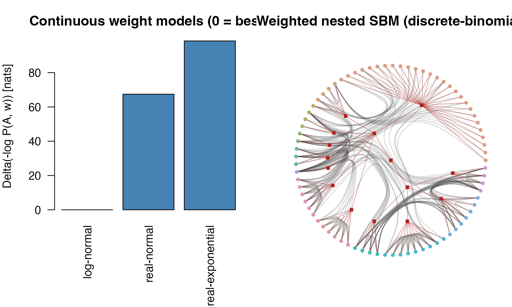

# Weighted & Layered Stochastic Block Models

This article combines the `weighted_sbm` and `layered_sbm` demos,
showing how to incorporate edge weights (discrete or continuous
covariates) and discrete multiplex layers into flat and nested SBMs.

## 1. Weighted / edge-covariate SBMs

`rgraphtool` implements all five Peixoto (2018) discrete and continuous
covariate distributions (`discrete-geometric`, `discrete-poisson`,
`discrete-binomial`, `real-exponential`, `real-normal`), including
simultaneous multi-covariate models and exact change-of-variables
log-Jacobians via
[`transform_weights()`](https://diogro.github.io/rgraphtool/reference/graph.md)
for comparing raw vs. log-transformed continuous models.

``` r

lesmis <- load_or_fallback_lesmis_weighted()
g <- lesmis$graph

w <- graph_edge_property(g, "value")
summary(w)
#>    Min. 1st Qu.  Median    Mean 3rd Qu.    Max. 
#>   1.000   1.000   2.000   3.228   4.000  31.000

# Discrete count covariate models (MAP description length)
set.seed(42)
cmp_disc <- compare_weight_models(
  g,
  weights = "value",
  nested = TRUE,
  method = "map",
  nruns = 3L
)
print(cmp_disc)
#> <weighted SBM model comparison (nested, DC, MAP)>
#>               model  B description_length jacobian_adj  delta posterior_weight
#>   discrete-binomial 12           1238.345            0  0.000         1.00e+00
#>    discrete-poisson 10           1250.209            0 11.863         7.04e-06
#>  discrete-geometric  5           1301.308            0 62.963         4.53e-28
#> Best weight model: discrete-binomial

# Continuous and log-transformed weight models with exact Jacobian adjustment
set.seed(42)
cmp_cont <- compare_weight_models(
  g,
  weights = "value",
  candidates = c("real-exponential", "real-normal", "log-normal"),
  nested = TRUE,
  method = "posterior",
  nsamples = 80L,
  thin = 5L,
  burnin = 40L
)
print(cmp_cont)
#> <weighted SBM model comparison (nested, DC, posterior/variational)>
#>             model B description_length jacobian_adj posterior_entropy
#>        log-normal 6           1176.268      205.164            32.017
#>       real-normal 6           1233.020        0.000            14.427
#>  real-exponential 5           1256.698        0.000            19.859
#>  neg_log_evidence  delta posterior_weight
#>          1150.539  0.000         1.00e+00
#>          1217.979 67.440         5.14e-30
#>          1249.032 98.493         1.68e-43
#> Best weight model: log-normal

best_w <- cmp_disc$best_state
set.seed(42)
unw <- minimize_nested_blockmodel_dl(g)
ov_w <- partition_overlap(nested_levels(best_w)[[1L]], nested_levels(unw)[[1L]],
                          norm = TRUE)
cat(sprintf("Level-0 partition overlap (weighted %s vs unweighted): %.3f\n",
            cmp_disc$best_model, ov_w))
#> Level-0 partition overlap (weighted discrete-binomial vs unweighted): 0.675

old_par <- graphics::par(mfrow = c(1L, 2L), mar = c(7, 4, 3, 1))
tab <- cmp_cont$summary
graphics::barplot(
  tab$delta,
  names.arg = tab$model,
  las = 2,
  ylab = "Delta(-log P(A, w)) [nats]",
  col = ifelse(tab$model == cmp_cont$best_model, "darkorange", "steelblue"),
  main = "Continuous weight models (0 = best)"
)
graphics::par(mar = c(2, 2, 3, 1))
plot_hierarchy(best_w,
               main = sprintf("Weighted nested SBM (%s)", cmp_disc$best_model))
```



``` r

graphics::par(old_par)
```

## 2. Layered (multiplex) SBMs

When discrete edge types stratify a network into layers,
[`compare_layered_models()`](https://diogro.github.io/rgraphtool/reference/compare_layered_models.md)
compares the **edge-covariate** hypothesis (`independent = FALSE`, where
layers are edge labels on a shared topology) against the **conditionally
independent layers** hypothesis (`independent = TRUE`, where each layer
is generated independently given the shared vertex partition).

``` r

cat(sprintf("N = %d vertices, E = %d edges, C = %d discrete layers\n",
            graph_num_vertices(g), graph_num_edges(g), length(unique(w))))
#> N = 77 vertices, E = 254 edges, C = 17 discrete layers

set.seed(42)
cmp_l_map <- compare_layered_models(
  g,
  layers = "value",
  models = c("edge_covariates_dc", "edge_covariates_ndc",
             "independent_layers_dc", "independent_layers_ndc"),
  nested = TRUE,
  method = "map",
  nruns = 3L
)
print(cmp_l_map)
#> <layered SBM model comparison (nested, 17 layers, MAP)>
#>                   model B description_length   delta posterior_weight
#>   independent_layers_dc 2            963.264   0.000         9.96e-01
#>  independent_layers_ndc 4            968.828   5.564         3.82e-03
#>     edge_covariates_ndc 7           1214.874 251.609        5.32e-110
#>      edge_covariates_dc 4           1219.804 256.539        3.84e-112
#> Best layered model: independent_layers_dc

set.seed(42)
cmp_l_post <- compare_layered_models(
  g,
  layers = "value",
  models = c("edge_covariates", "independent_layers"),
  nested = TRUE,
  method = "posterior",
  nsamples = 80L,
  thin = 5L,
  burnin = 40L
)
print(cmp_l_post)
#> <layered SBM model comparison (nested, 17 layers, posterior/variational)>
#>               model B description_length posterior_entropy neg_log_evidence
#>  independent_layers 2            963.264             6.882          956.298
#>     edge_covariates 4           1222.992            11.825         1206.045
#>    delta posterior_weight
#>    0.000         1.00e+00
#>  249.747        3.44e-109
#> Best layered model: independent_layers

best_l <- cmp_l_post$best_state
old_par <- graphics::par(mfrow = c(1L, 2L), mar = c(9, 4, 3, 1))
tab_l <- cmp_l_map$summary
graphics::barplot(
  tab_l$delta,
  names.arg = tab_l$model,
  las = 2,
  ylab = "Delta(DL) [nats]",
  col = ifelse(tab_l$model == cmp_l_map$best_model, "darkorange", "steelblue"),
  main = "Layered model variants (0 = best)"
)
graphics::par(mar = c(2, 2, 3, 1))
plot_hierarchy(best_l,
               main = sprintf("Layered SBM (%s)", cmp_l_post$best_model))
```


``` r

graphics::par(old_par)
```
