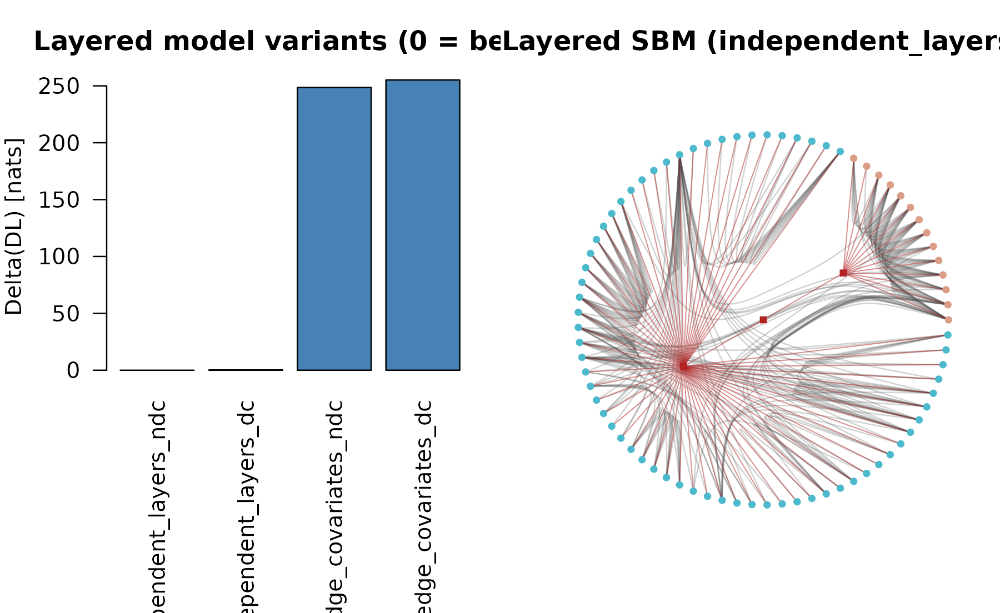

# Weighted & Layered Stochastic Block Models

This article combines the `weighted_sbm` and `layered_sbm` demos,
showing how to incorporate edge weights (discrete or continuous
covariates) and discrete multiplex layers into flat and nested SBMs.

## 1. Weighted / edge-covariate SBMs

`rgraphtool` implements all five Peixoto (2018) discrete and continuous
covariate distributions (`discrete-geometric`, `discrete-poisson`,
`discrete-binomial`, `real-exponential`, `real-normal`), including
simultaneous multi-covariate models and exact change-of-variables
log-Jacobians via
[`transform_weights()`](https://diogro.github.io/rgraphtool/reference/graph.md)
for comparing raw vs. log-transformed continuous models.

\
`lesmis`` ``<-`` ``load_or_fallback_lesmis_weighted``(``)`\
`g`` ``<-`` ``lesmis``$``graph`\
\
`w`` ``<-`` `[`graph_edge_property`](https://diogro.github.io/rgraphtool/reference/graph.md)`(``g``, ``"value"``)`\
[`summary`](https://rdrr.io/r/base/summary.html)`(``w``)`\
`#>    Min. 1st Qu.  Median    Mean 3rd Qu.    Max. `\
`#>   1.000   1.000   2.000   3.228   4.000  31.000`\
\
`# Discrete count covariate models (MAP description length)`\
[`set.seed`](https://rdrr.io/r/base/Random.html)`(``42``)`\
`cmp_disc`` ``<-`` `[`compare_weight_models`](https://diogro.github.io/rgraphtool/reference/compare_weight_models.md)`(`\
`  ``g``,`\
`  weights ``=`` ``"value"``,`\
`  nested ``=`` ``TRUE``,`\
`  method ``=`` ``"map"``,`\
`  nruns ``=`` ``3L`\
`)`\
[`print`](https://rdrr.io/r/base/print.html)`(``cmp_disc``)`\
`#> <weighted SBM model comparison (nested, DC, MAP)>`\
`#>               model  B description_length jacobian_adj  delta posterior_weight`\
`#>   discrete-binomial 12           1245.055            0  0.000         7.30e-01`\
`#>    discrete-poisson  9           1246.049            0  0.994         2.70e-01`\
`#>  discrete-geometric  5           1301.671            0 56.616         1.88e-25`\
`#> Best weight model: discrete-binomial`\
\
`# Continuous and log-transformed weight models with exact Jacobian adjustment`\
[`set.seed`](https://rdrr.io/r/base/Random.html)`(``42``)`\
`cmp_cont`` ``<-`` `[`compare_weight_models`](https://diogro.github.io/rgraphtool/reference/compare_weight_models.md)`(`\
`  ``g``,`\
`  weights ``=`` ``"value"``,`\
`  candidates ``=`` `[`c`](https://rdrr.io/r/base/c.html)`(``"real-exponential"``, ``"real-normal"``, ``"log-normal"``)``,`\
`  nested ``=`` ``TRUE``,`\
`  method ``=`` ``"posterior"``,`\
`  nsamples ``=`` ``80L``,`\
`  thin ``=`` ``5L``,`\
`  burnin ``=`` ``40L`\
`)`\
[`print`](https://rdrr.io/r/base/print.html)`(``cmp_cont``)`\
`#> <weighted SBM model comparison (nested, DC, posterior/variational)>`\
`#>             model B description_length jacobian_adj posterior_entropy`\
`#>        log-normal 8           1160.054      205.164            26.079`\
`#>       real-normal 6           1251.396        0.000             9.892`\
`#>  real-exponential 5           1256.703        0.000            10.016`\
`#>  neg_log_evidence   delta posterior_weight`\
`#>          1139.358   0.000         1.00e+00`\
`#>          1204.992  65.634         3.13e-29`\
`#>          1253.457 114.099         2.80e-50`\
`#> Best weight model: log-normal`\
\
`best_w`` ``<-`` ``cmp_disc``$``best_state`\
[`set.seed`](https://rdrr.io/r/base/Random.html)`(``42``)`\
`unw`` ``<-`` `[`minimize_nested_blockmodel_dl`](https://diogro.github.io/rgraphtool/reference/minimize_nested_blockmodel_dl.md)`(``g``)`\
`ov_w`` ``<-`` `[`partition_overlap`](https://diogro.github.io/rgraphtool/reference/partition_mode_state.md)`(`[`nested_levels`](https://diogro.github.io/rgraphtool/reference/minimize_nested_blockmodel_dl.md)`(``best_w``)``[[``1L``]``]``, `[`nested_levels`](https://diogro.github.io/rgraphtool/reference/minimize_nested_blockmodel_dl.md)`(``unw``)``[[``1L``]``]``,`\
`                          norm ``=`` ``TRUE``)`\
[`cat`](https://rdrr.io/r/base/cat.html)`(`[`sprintf`](https://rdrr.io/r/base/sprintf.html)`(``"Level-0 partition overlap (weighted %s vs unweighted): %.3f\n"``,`\
`            ``cmp_disc``$``best_model``, ``ov_w``)``)`\
`#> Level-0 partition overlap (weighted discrete-binomial vs unweighted): 0.649`\
\
`old_par`` ``<-`` ``graphics``::`[`par`](https://rdrr.io/r/graphics/par.html)`(``mfrow ``=`` `[`c`](https://rdrr.io/r/base/c.html)`(``1L``, ``2L``)``, mar ``=`` `[`c`](https://rdrr.io/r/base/c.html)`(``7``, ``4``, ``3``, ``1``)``)`\
`tab`` ``<-`` ``cmp_cont``$``summary`\
`graphics``::`[`barplot`](https://rdrr.io/r/graphics/barplot.html)`(`\
`  ``tab``$``delta``,`\
`  names.arg ``=`` ``tab``$``model``,`\
`  las ``=`` ``2``,`\
`  ylab ``=`` ``"Delta(-log P(A, w)) [nats]"``,`\
`  col ``=`` `[`ifelse`](https://rdrr.io/r/base/ifelse.html)`(``tab``$``model`` ``==`` ``cmp_cont``$``best_model``, ``"darkorange"``, ``"steelblue"``)``,`\
`  main ``=`` ``"Continuous weight models (0 = best)"`\
`)`\
`graphics``::`[`par`](https://rdrr.io/r/graphics/par.html)`(``mar ``=`` `[`c`](https://rdrr.io/r/base/c.html)`(``2``, ``2``, ``3``, ``1``)``)`\
[`plot_hierarchy`](https://diogro.github.io/rgraphtool/reference/plot_hierarchy.md)`(``best_w``,`\
`               main ``=`` `[`sprintf`](https://rdrr.io/r/base/sprintf.html)`(``"Weighted nested SBM (%s)"``, ``cmp_disc``$``best_model``)``)`

\
`graphics``::`[`par`](https://rdrr.io/r/graphics/par.html)`(``old_par``)`

## 2. Layered (multiplex) SBMs

When discrete edge types stratify a network into layers,
[`compare_layered_models()`](https://diogro.github.io/rgraphtool/reference/compare_layered_models.md)
compares the **edge-covariate** hypothesis (`independent = FALSE`, where
layers are edge labels on a shared topology) against the **conditionally
independent layers** hypothesis (`independent = TRUE`, where each layer
is generated independently given the shared vertex partition).

\
[`cat`](https://rdrr.io/r/base/cat.html)`(`[`sprintf`](https://rdrr.io/r/base/sprintf.html)`(``"N = %d vertices, E = %d edges, C = %d discrete layers\n"``,`\
`            `[`graph_num_vertices`](https://diogro.github.io/rgraphtool/reference/graph.md)`(``g``)``, `[`graph_num_edges`](https://diogro.github.io/rgraphtool/reference/graph.md)`(``g``)``, `[`length`](https://rdrr.io/r/base/length.html)`(`[`unique`](https://rdrr.io/r/base/unique.html)`(``w``)``)``)``)`\
`#> N = 77 vertices, E = 254 edges, C = 17 discrete layers`\
\
[`set.seed`](https://rdrr.io/r/base/Random.html)`(``42``)`\
`cmp_l_map`` ``<-`` `[`compare_layered_models`](https://diogro.github.io/rgraphtool/reference/compare_layered_models.md)`(`\
`  ``g``,`\
`  layers ``=`` ``"value"``,`\
`  models ``=`` `[`c`](https://rdrr.io/r/base/c.html)`(``"edge_covariates_dc"``, ``"edge_covariates_ndc"``,`\
`             ``"independent_layers_dc"``, ``"independent_layers_ndc"``)``,`\
`  nested ``=`` ``TRUE``,`\
`  method ``=`` ``"map"``,`\
`  nruns ``=`` ``3L`\
`)`\
[`print`](https://rdrr.io/r/base/print.html)`(``cmp_l_map``)`\
`#> <layered SBM model comparison (nested, 17 layers, MAP)>`\
`#>                   model B description_length   delta posterior_weight`\
`#>  independent_layers_ndc 4            961.466   0.000         5.41e-01`\
`#>   independent_layers_dc 3            961.630   0.164         4.59e-01`\
`#>     edge_covariates_ndc 7           1210.021 248.555        6.13e-109`\
`#>      edge_covariates_dc 4           1216.658 255.193        8.02e-112`\
`#> Best layered model: independent_layers_ndc`\
\
[`set.seed`](https://rdrr.io/r/base/Random.html)`(``42``)`\
`cmp_l_post`` ``<-`` `[`compare_layered_models`](https://diogro.github.io/rgraphtool/reference/compare_layered_models.md)`(`\
`  ``g``,`\
`  layers ``=`` ``"value"``,`\
`  models ``=`` `[`c`](https://rdrr.io/r/base/c.html)`(``"edge_covariates"``, ``"independent_layers"``)``,`\
`  nested ``=`` ``TRUE``,`\
`  method ``=`` ``"posterior"``,`\
`  nsamples ``=`` ``80L``,`\
`  thin ``=`` ``5L``,`\
`  burnin ``=`` ``40L`\
`)`\
[`print`](https://rdrr.io/r/base/print.html)`(``cmp_l_post``)`\
`#> <layered SBM model comparison (nested, 17 layers, posterior/variational)>`\
`#>               model B description_length posterior_entropy neg_log_evidence`\
`#>  independent_layers 2            963.264             6.568          956.758`\
`#>     edge_covariates 4           1240.402            13.392         1205.275`\
`#>    delta posterior_weight`\
`#>    0.000         1.00e+00`\
`#>  248.517        1.18e-108`\
`#> Best layered model: independent_layers`\
\
`best_l`` ``<-`` ``cmp_l_post``$``best_state`\
`old_par`` ``<-`` ``graphics``::`[`par`](https://rdrr.io/r/graphics/par.html)`(``mfrow ``=`` `[`c`](https://rdrr.io/r/base/c.html)`(``1L``, ``2L``)``, mar ``=`` `[`c`](https://rdrr.io/r/base/c.html)`(``9``, ``4``, ``3``, ``1``)``)`\
`tab_l`` ``<-`` ``cmp_l_map``$``summary`\
`graphics``::`[`barplot`](https://rdrr.io/r/graphics/barplot.html)`(`\
`  ``tab_l``$``delta``,`\
`  names.arg ``=`` ``tab_l``$``model``,`\
`  las ``=`` ``2``,`\
`  ylab ``=`` ``"Delta(DL) [nats]"``,`\
`  col ``=`` `[`ifelse`](https://rdrr.io/r/base/ifelse.html)`(``tab_l``$``model`` ``==`` ``cmp_l_map``$``best_model``, ``"darkorange"``, ``"steelblue"``)``,`\
`  main ``=`` ``"Layered model variants (0 = best)"`\
`)`\
`graphics``::`[`par`](https://rdrr.io/r/graphics/par.html)`(``mar ``=`` `[`c`](https://rdrr.io/r/base/c.html)`(``2``, ``2``, ``3``, ``1``)``)`\
[`plot_hierarchy`](https://diogro.github.io/rgraphtool/reference/plot_hierarchy.md)`(``best_l``,`\
`               main ``=`` `[`sprintf`](https://rdrr.io/r/base/sprintf.html)`(``"Layered SBM (%s)"``, ``cmp_l_post``$``best_model``)``)`

\
`graphics``::`[`par`](https://rdrr.io/r/graphics/par.html)`(``old_par``)`
